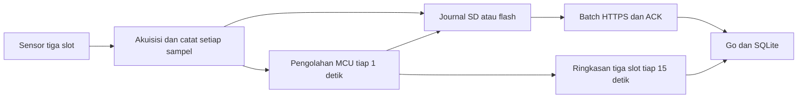

# TSD SIGAP ESP32 S3 dan Arsip Telemetri Seluruh Sampel

Versi 1.2 · 1 Oktober 2026 · Technical design normative untuk implementation planning

Dokumen ini menjabarkan [PRD Firmware SIGAP ESP32 S3 dengan PlatformIO v1.3](PRD_Firmware_SIGAP_ESP32S3_PlatformIO.md) menjadi rancangan firmware, configuration/provisioning architecture, protokol pengiriman, dan perubahan backend. Satu ESP32-S3 DevKitC-1 N16R8 mengakuisisi sensor untuk tiga slot, menjalankan kalibrasi serta fuzzy dan safety lokal, lalu mencatat **setiap sampel yang diperoleh dan setiap hasil per siklus**. Backend Go mengautentikasi, memvalidasi, menyimpan, membaca, dan mengekspor data tersebut tanpa menghitung ulang keputusan perangkat.

TSD ini adalah spesifikasi untuk pekerjaan mendatang. Angka sampling, ukuran record, kapasitas, pin, dan konfigurasi build mengikuti profil awal PRD; semuanya harus diuji dengan modul dan revisi PCB nyata sebelum dinyatakan siap produksi. Tidak ada firmware, endpoint, migrasi, atau hasil uji hardware yang dinyatakan sudah dibuat oleh dokumen ini.

## 1 Batas sistem dan keputusan arsitektur

| Area | Keputusan teknis | Batas dan sumber keputusan |
| --- | --- | --- |
| Controller | Satu ESP32-S3 N16R8 untuk organik, anorganik, B3; C++ dan Arduino pada PlatformIO. | PRD §§3–8; profil memori/pin diperiksa pada board aktual. |
| Pengolahan | Filter, konversi, normalisasi, FIS Mamdani, verified-empty, dan safety B3 dieksekusi di MCU. | Model numerik produksi masih perlu validasi ilmiah. |
| Akuisisi | Seluruh frame/sampel dari semua sensor dicatat, termasuk kualitas invalid dan trial kalibrasi. | Tidak ada sampling selektif karena jaringan, hasil filter, atau ringkasan. |
| Penyimpanan | microSD menjadi logger utama bila sehat, LittleFS menjadi fallback; record dan batch pending immutable sampai ACK server. | SD opsional secara hardware, kapasitas offline panjang bergantung pada kartu teruji. |
| Transport | HTTPS/Wi-Fi P0; ringkasan v2 pada `POST /api/ingest`, arsip lengkap v3 pada endpoint batch baru. | BLE gateway P1 setelah spike; gateway receipt bukan ACK server. |
| Backend | Go `net/http` dan SQLite dalam repo; migrasi menambah arsip record serta receipt batch. | Tidak menjalankan FIS, kompensasi, normalisasi, atau safety untuk data `HARDWARE_EDGE_V3`. |
| Configuration | Compile-time board/build constants terpisah dari versioned `AppConfig`, `SecretStore`, calibration/model profiles, dan `RuntimeState`. | Tidak ada mutable non-const global configuration; P0 mengaktifkan config baru setelah controlled reboot. |
| Antarmuka | Dashboard tetap membaca status terbaru dengan usia data; riset/ekspor membaca seluruh record secara bertahap. | Prioritas current memakai waktu ukur tepercaya; data UTC-null tetap dapat ditelusuri. |



**Invarian:** `acquired` berarti driver benar-benar memperoleh frame atau mencatat attempt yang gagal; `durable` berarti record lolos batas flush/checkpoint yang didefinisikan logger; `server_acked` berarti backend menyimpan record dan receipt secara transaksional serta ACK tervalidasi di perangkat. Ketiga counter berbeda. `acquired > durable` memerlukan gap/fault yang terlihat; record pending tidak dihapus hanya karena sambungan radio berhasil. Pada kehilangan daya mendadak, kemungkinan tail yang belum durable harus diukur dan dilaporkan, bukan disembunyikan sebagai keberhasilan.

## 2 Kesesuaian repo dan tata letak pekerjaan

Landasan historis adalah `main` commit `6fed00f02b6ef7dabc159d924f798d344a6072ba`. Reconciliation revisi 1.2 dilakukan terhadap `main` commit `7dd35f6d05cde09fe31a8a2f56933d04e4dc456a` pada 1 Oktober 2026.

| Commit | Dampak | Keputusan |
| --- | --- | --- |
| `98e4439` | Runtime/schema ingest, fuzzy, safety, history/read API, simulator, migration 004. | Pertahankan sebagai compatibility surface legacy. |
| `292aa47` | PRD/TSD firmware awal. | Digantikan oleh revisi normative ini bila konflik. |
| `a0a9dc9` | Reconciliation migration/runtime docs/test. | Basis reconciliation sebelum config architecture. |
| `7dd35f6` | Lima skill upstream embedded/config/C++ di-merge. | Gunakan sebagai engineering guidance; PRD/TSD tetap authority. |

Skill yang materially memengaruhi desain ini:
- `esp32-development`: exact-board evidence, partition/recovery, calibration/security boundary;
- `embedded-development`: explicit ownership, no global implicit synchronization, persistence/resource constraints;
- `cpp-coding-standards`: immutability default dan avoid non-const global variables;
- `config-nvs`: NVS/Preferences persistence pattern yang **diadaptasi**, bukan disalin mentah;
- `memory-audit`: stack/heap/static allocation harus dibuktikan pada target.

Project-specific assumption dari upstream skill tidak otomatis berlaku pada SIGAP. Contohnya, `config-nvs` memakai static `ConfigManager`; TSD ini memilih instance-owned manager + immutable per-boot snapshot karena lebih sesuai dengan ownership requirement SIGAP.

### Target tree

```text
firmware/
├── platformio.ini
├── partitions_n16r8.csv
├── include/sigap/
│   ├── board/board_pins.h
│   ├── build/{build_config,firmware_version}.h
│   └── config/config_defaults.h
├── src/
│   ├── main.cpp
│   └── app/{sigap_app.h,sigap_app.cpp}
├── lib/
│   ├── config/{config_types,config_manager,config_validator,config_codec,nvs_config_store}.*
│   ├── provisioning/{secret_store,usb_provisioning}.*
│   ├── profiles/
│   ├── calibration/
│   ├── sensors/{hx711,ultrasonic,mq_adc,ds18b20,sht31}/
│   ├── heater/
│   ├── processing/
│   ├── fuzzy/
│   ├── safety/
│   ├── models/
│   ├── storage/{record_codec,segment,journal,sd_backend,flash_backend}/
│   ├── telemetry/{batch_builder,serializer,http_client,ack_validator,retry_policy}/
│   └── runtime/{scheduler,timebase,health,watchdog,usb_maintenance}/
├── data/{models,factory_defaults}/
└── test/{native,contract,target}/

internal/telemetry/
internal/http/telemetry_batch_handler.go
migrations/005_telemetry_archive.sql   # expected only; recheck HEAD
```

Migration terakhir tetap `004_device_research_trace.sql`; `005` adalah expected next number pada HEAD reconciliation dan tidak dianggap reserved.

`firmware/` adalah boundary kompilasi MCU. Driver tidak membaca HTTP/SQLite/global config. `SigapApp` adalah composition root dan memiliki manager/service instances. Modul menerima typed configuration yang dibutuhkan pada construction/`begin()`. History legacy mempertahankan cursor `(recorded_at,reading_id)`; archive memakai `(device_id,boot_id,sequence)`.

## 3 Profil board, pin, daya dan build

Gunakan profil PlatformIO dari PRD: `espressif32@7.1.3`, `esp32-s3-devkitc-1`, framework Arduino, `board_upload.flash_size = 16MB`, `board_build.flash_mode = qio`, `board_build.arduino.memory_type = qio_opi`, `board_build.psram_type = opi`, filesystem LittleFS, serta env `sigap_n16r8`, `sigap_n16r8_sd`, `sigap_bench`, dan `native`. Dependency sensor/JSON **baru dipin sesudah spike compile** pada versi platform tersebut; jangan mengasumsikan API Arduino 3.x. Konfigurasi ini menurunkan PRD, belum bukti bahwa setiap board berlabel N16R8 memakai topologi memori yang sama.

Partisi awal mengikuti PRD: `nvs` offset `0x9000` ukuran `0x5000`, `phy_init` `0xe000`/`0x1000`, `factory` `0x10000`/`0x400000`, dan `spiffs` `0x410000`/`0x800000` yang dipasang sebagai LittleFS. File manifest/profil besar berada di filesystem, NVS memuat pointer versi aktif dan data konfigurasi kecil. Lakukan cek batas ukuran image, konflik partisi, kapasitas NVS, ruang kerja model, serta mounting FS pada target sebelum freeze; konfigurasi tanpa OTA.

| Perangkat | Slot | GPIO pada profil awal |
| --- | --- | --- |
| MQ-4, MQ-135, MQ-7, MQ-8 melalui divider ADC1 | Organik, organik, B3, B3 | 4, 5, 6, 7 |
| HX711 DOUT/SCK | Organik; anorganik; B3 | 10/11; 12/13; 14/15 |
| Ultrasonic TRIG/ECHO | Organik; anorganik; B3 | 16/17; 18/21; 47/42 |
| DS18B20 1-Wire; MQ-7 heater select | B3 | 2; 1 |
| SHT31 SDA/SCL, alamat `0x44`/`0x45` | Organik; B3 | 8/9 bersama |
| microSD SPI SCK/MISO/MOSI/CS | Opsional | 39/40/41/43 |

Pin 43 untuk CS mengambil fungsi UART0 TX pada DevKitC; maintenance menggunakan USB native. Jangan memakai pin strapping 0/3/45/46, pin memori 26–37, USB 19/20, atau 38/48 yang dapat berbenturan dengan RGB menurut revisi board. Periksa header, schematic, level logic, dan kondisi CS/heater saat reset. GPIO 39–42 dipakai sehingga rencana debug tidak boleh bergantung pada JTAG eksternal. Seluruh GPIO digital menerima level 3,3 V: ECHO 5 V dan keluaran analog MQ melalui divider; heater MQ tidak mengambil arus dari GPIO. Tegangan fase MQ-7 berasal dari datasheet modul yang benar-benar dipasang, sedangkan contoh 5 V/60 s dan 1,5 V/90 s pada PRD hanya berlaku untuk profil contoh MQ-7B.

## 3A Configuration, provisioning, dan profile architecture

### 3A.1 Prinsip ownership

Tidak ada `global_variables.h` berisi mutable setting dan tidak ada `extern AppConfig config` yang dapat ditulis modul mana pun. Satu boot menggunakan **satu immutable active snapshot**. Mutable draft hanya hidup di maintenance/config manager dan tidak pernah dipinjam task runtime.

Klasifikasi state:

| Jenis | Owner | Persistensi | Contoh |
| --- | --- | --- | --- |
| `BuildConfig` | build system | image | protocol hard limit, feature flag |
| `BoardConfig` | board profile | image | GPIO, bus, partition |
| `AppConfig` | `ConfigManager` | NVS A/B snapshot | sampling, summary, retry, bounded quota |
| `SecretStore` | provisioning service | NVS namespace terpisah | SSID/password/device token |
| `CalibrationProfile` | profile/calibration manager | versioned profile + active pointer | tare, scale, D_empty/D_full |
| `ModelProfile` | profile manager | versioned profile + active pointer | FIS/safety |
| `RuntimeState` | runtime services | RAM/checkpoint khusus | Wi-Fi state, queue, counters, heater phase |

`AppConfig` tidak menyimpan secret, calibration coefficient, FIS rules, safety threshold, raw runtime counters, GPIO, atau wire-contract semantics.

### 3A.2 AppConfig schema

Config schema version berbeda dari telemetry schema version.

```cpp
// firmware/lib/config/config_types.h
#pragma once
#include <cstdint>

namespace sigap::config {

struct SamplingConfig {
  uint32_t hx711_period_ms{100};
  uint32_t mq_period_ms{100};
  uint32_t ultrasonic_period_ms{1000};
  uint32_t ds18b20_period_ms{1000};
  uint32_t sht31_period_ms{2000};
};

struct TelemetryConfig {
  uint32_t summary_period_ms{15000};
  uint16_t max_records_per_batch{128};
  uint32_t retry_min_ms{1000};
  uint32_t retry_max_ms{60000};
};

struct StorageConfig {
  uint64_t flash_pending_quota_bytes{6ULL * 1024 * 1024};
  uint64_t sd_pending_quota_bytes{20ULL * 1024 * 1024 * 1024};
};

struct AppConfig {
  uint32_t schema_version{1};
  uint64_t config_version{0};
  SamplingConfig sampling{};
  TelemetryConfig telemetry{};
  StorageConfig storage{};
};

}  // namespace sigap::config
```

Defaults adalah engineering defaults, bukan hasil ilmiah. Validator memeriksa per-field bounds **dan cross-field constraints**. Contoh: `retry_min_ms <= retry_max_ms`; batch count tidak boleh melampaui hard contract; flash quota tidak boleh memakan reserve journal/profile; ultrasonic timing tidak boleh melanggar acoustic gap profile.

### 3A.3 Config identity dan provenance

`config_hash` = SHA-256 dari bytes serialized snapshot yang telah lolos deterministic codec. Hash bukan secret dan boleh masuk telemetry. `config_version` monotonik per device dan diserialisasi sebagai decimal string di JSON bila dapat melampaui safe integer JavaScript.

Semua sample/result/event/metadata record menyimpan:

```json
{
  "config_ref": {
    "schema_version": 1,
    "config_version": "4",
    "config_hash": "sha256:..."
  }
}
```

Manifest config non-secret dapat diarsipkan terpisah untuk reproduktibilitas. Credential tidak pernah ikut manifest.

### 3A.4 NVS A/B snapshot

Jangan menganggap rangkaian beberapa `Preferences::put*` sebagai transaksi atomik seluruh config. Simpan satu encoded snapshot pada slot inactive, verifikasi readback, lalu pindahkan active pointer.

State:
`ACTIVE → DRAFT → VALIDATE → PREVIEW → COMMIT → REBOOT_REQUIRED → ACTIVE`.

Boot algorithm:
1. baca active pointer;
2. decode/validate/hash slot active;
3. bila invalid, coba other slot yang valid;
4. bila unit belum provisioned dan kedua slot kosong, factory defaults boleh menjadi initial draft;
5. bila unit sudah provisioned tetapi tidak ada snapshot valid, masuk `CONFIG_REQUIRED` maintenance; jangan silent factory reset;
6. setiap activation menulis event provenance.

P0 selalu **apply on reboot** untuk sampling/network/storage setting. Hot reload bukan requirement P0.

### 3A.5 Secret boundary

`SecretStore` mempunyai namespace/key terpisah. Firmware internal dapat membaca secret untuk network/auth, tetapi maintenance UI tidak menyediakan getter plaintext. Command hanya `set`, `rotate`, `clear` dengan explicit confirmation, dan `status` redacted.

Token rotation tidak mengubah immutable pending body karena token berada di HTTP Authorization header.

### 3A.6 Factory reset semantics

Empat operasi berbeda:
- `config reset`: reset AppConfig ke draft defaults, tidak menghapus secret/profile/archive;
- `secret clear`: menghapus credential setelah explicit confirmation;
- `profile reset <kind>`: menonaktifkan profile tertentu tanpa menghapus archive;
- `factory erase all`: destructive maintenance action terpisah dengan warning dan physical USB.


## 4 Kontrak internal record dan waktu

Semua jenis record berbagi envelope semantik. Serialisasi transport boleh JSON, sedangkan segmen lokal boleh memakai representasi biner berframing selama nilai asli dan byte batch yang dikirim dapat dipertahankan tepat. Schema v3 dikelola sebagai fixture bersama C++/Go. Unit, nullability, rentang, enum, max length dan versi wajib didefinisikan per field dalam kontrak final.

| Field | Aturan |
| --- | --- |
| `device_id`, `boot_id`, `sequence`, `record_id` | Device code hasil provisioning, boot ID acak unik per boot, sequence uint64 per boot; record ID = gabungan tiga komponen. Alokasikan sequence untuk sample, result, event, dan metadata dari satu sumber. |
| `kind`, `sensor_id`, `stream` | `sample`, `result`, `event`, `metadata`; sensor/slot harus dikenal pada profil board dan schema. |
| `monotonic_us`, `recorded_at`, `time_quality` | Waktu monotonic diambil sedekat mungkin dengan akuisisi; UTC string RFC3339 atau null; quality `SYNCED`, `RECONSTRUCTED`, `UNSYNCED` dengan uncertainty/anchor jika ada. |
| `raw`, `converted`, `quality`, `reason` | Raw sesuai protokol sensor; hasil konversi hanya jika valid; quality/reason menjelaskan validitas tanpa membuat nilai palsu. |
| `config_ref`, `profile_refs` | `config_ref` memuat schema/version/hash AppConfig aktif. `profile_refs` memuat calibration, capacity, FIS, safety serta firmware/model refs. Manifest non-secret diarsipkan berdasarkan hash. |
| `source_sample_ids` | Hasil satu siklus memuat semua record ID sampel yang berkontribusi pada setiap filter/input. Nilai daftar tidak boleh dipotong untuk menyesuaikan body. |

**Representasi uint64 JSON:** sequence diserialisasi sebagai string desimal (misalnya `"901"`) dalam rancangan final agar consumer JavaScript tidak kehilangan presisi di atas `2^53−1`. Parser Go memeriksa string digit, overflow uint64, dan kesinambungan identitas. Contoh angka JSON dalam PRD adalah ilustrasi dan perlu diselaraskan dengan fixture kontrak v3 sebelum implementasi. `boot_id` berasal dari sumber random perangkat yang diuji, tidak bergantung pada NTP atau MAC saja. Record ID persisten sudah dialokasikan sebelum append; counter global tidak direkonstruksi dari UTC.

Clock anchor adalah event append-only `{boot_id, monotonic_us, utc, uncertainty_us, source}`. Sinkronisasi NTP berikutnya menambahkan anchor baru, termasuk bila jam dikoreksi mundur; tidak menulis ulang `recorded_at` pada record lama. Query boleh menghitung `derived_at` dan provenance anchor sebagai kolom baca terpisah. Boot yang tidak pernah memperoleh anchor tetap UTC-null; backend menerima dan mengekspornya. Ringkasan legacy dibuat untuk `POST /api/ingest` saat UTC tepercaya tersedia; cold boot tanpa UTC tetap mengarsip semua sample/result, kemudian mengirim ringkasan baru setelah sinkronisasi. Ringkasan tidak mewakili jumlah arsip.

## 5 Akuisisi sensor dan penjadwalan

Target sampling awal PRD menghasilkan 75 frame sensor/s dan tiga result/s: tiga HX711 ×10 SPS =30, empat MQ ×10 Hz =40, tiga ultrasonic ×1 Hz =3, satu DS18B20 ×1 Hz =1, dua SHT31 ×0,5 Hz =1 frame/s. Satu frame SHT31 berisi suhu dan RH sekaligus, sehingga keduanya tersedia tanpa menghitung frame dua kali. Laju di dalam profil bersifat eksplisit dan perubahannya menambah event versi baru. Sampling tetap berlangsung saat Wi-Fi tidak ada; tidak ada penurunan laju tersembunyi. Varian HX711 80 SPS harus melalui perhitungan CPU, logger, SD dan backend ulang.

| Driver | Frame yang dicatat | Penanganan operasi |
| --- | --- | --- |
| HX711 ×3 | Signed counts dari setiap data ready, gain/channel, slot, mode 10/80 SPS, waktu dan quality. | Baca saat ready dengan timeout; tare/faktor berlaku per slot. Pengukuran negatif besar tetap ada di raw meski hasil kg null. |
| Ultrasonic ×3 | Trigger ID, lebar pulsa ECHO us bila ada, timeout/range, waktu. | Trigger bergantian; gap awal 60 ms dan timeout awal 30 ms dari PRD sampai model diketahui. ISR/RMT dipilih setelah spike kompatibilitas. |
| MQ-4/135/7/8 | ADC counts setiap 100 ms per kanal, mV bila kalibrasi ADC sah, divider, state heater, quality. | Fase MQ-7 `HIGH_CLEAN` tetap mempunyai sampel raw dengan hasil gas operasional null. Jangan mengklaim ppm/OGI tanpa profil ilmiah. |
| DS18B20 | ROM, scratchpad byte, CRC, konversi selesai, suhu bila sah. | Request nonblocking; pada 12 bit izinkan waktu konversi hingga 750 ms menurut profil awal. Jangan perlakukan power-on 85 °C sebelum conversion valid sebagai suhu. |
| SHT31 ×2 | Raw word/frame termasuk CRC untuk `0x44` dan `0x45`, suhu dan RH jika valid. | Bus I2C satu pemilik; CRC/timeout per alamat. Satu sensor gagal tidak menghentikan alamat lain. |

Akuisisi memakai scheduler monotonic dan deadline per kanal. Task sensor menjadi pemilik tunggal driver dan bus I2C; transfer record ke logger melalui antrean RAM bounded dengan indikator high-water dan overrun. Result worker memperoleh snapshot immutable keadaan sensor pada batas siklus 1 detik, termasuk ID jendela raw yang dipakai filter. Storage dan HTTPS tidak berjalan di critical timing path. Serial maintenance tidak memblokir akuisisi. Watchdog menilai progres akuisisi, logger, dan worker berdasarkan heartbeat serta deadline nyata; konfigurasi task/stack/queue dibekukan setelah pengukuran heap, PSRAM dan tail latency, bukan angka spekulatif di dokumen ini.

Jika buffer penuh, jangan diam-diam overwrite sampel; tingkatkan `unlogged_records` dan event gap dengan rentang sequence, sensor, alasan, serta waktu. Attempt sensor yang gagal membuat sample record `raw:null` dengan quality `TIMEOUT`, `CRC_ERROR` atau `DISCONNECTED` dan byte parsial yang benar-benar didapat bila ada. `STALE` berlaku pada pemilihan input pengolahan dan tidak mengubah sample historis menjadi pembacaan baru.

## 6 Pengolahan lokal per detik

Pipeline setiap slot berurutan: pilih sampel dalam jendela dan cek age/quality → simpan daftar `source_sample_ids` → filter/konversi menggunakan profil aktif → normalisasi input berdasar kapasitas slot → evaluasi FIS sesuai manifest → evaluasi safety B3 terpisah → bentuk result record walaupun hasil invalid → serahkan ke logger. Perubahan model/kalibrasi memakai pointer manifest yang difreeze pada awal siklus agar satu record tidak mencampur dua versi. Hasil dikirim setelah durable, tidak dihitung ulang pada replay.

Fill memakai `100 × (D_empty − D_measured)/(D_empty − D_full)` dengan syarat `D_empty > D_full`; overshoot kecil hanya di-clamp menurut tolerance terkalibrasi. Berat memakai offset tare dan counts/kg per slot; `weight_utilization_pct = 100 × weight_kg/operational_capacity_kg`. Capacity kg berasal dari mekanik, bukan otomatis rating load cell 20 kg. Input invalid menghasilkan null dan reason. Accumulation berasal dari `last_verified_empty` per slot, dengan hysteresis/stability dari profil ilmiah; kalibrasi atau reboot tidak membuat event kosong otomatis. Jika durasi lintas boot tidak diketahui karena UTC belum valid, hasil durasi null.

### FIS Mamdani yang dapat diaudit

Manifest FIS menentukan input wajib beserta unit/domain, urutan himpunan, fungsi tri/trap, daftar rule ber-ID stabil, operator `AND=min` dan `OR=max`, clipping `min`, agregasi `max`, grid/resolusi centroid, epsilon area, threshold label, serta `fis_version`/hash. Runtime menolak parameter non-finite, shoulder tidak valid, rule coverage yang tidak lengkap, overflow ukuran trace, dan domain yang tak cocok. Area nol, input hilang/stale/CALIBRATING, atau model rusak menghasilkan `score:null`, `state:UNAVAILABLE`/`UNCONFIGURED`, dan alasan yang dicatat. Fallback ke profil dua input hanya bila diaktifkan eksplisit dan mempunyai identitas model berbeda.

Profil dua input bench `TEST_ONLY` dari PRD memakai fill dan weight utilization masing-masing `trap[0,0,30,50]`, `tri[30,50,70]`, `trap[50,70,100,100]`; output mempunyai bentuk yang sama. Matriks rule: fill rendah terhadap berat rendah/sedang/tinggi menghasilkan Normal/Waspada/Angkat; fill sedang menghasilkan Waspada/Waspada/Angkat; fill tinggi menghasilkan Angkat/Angkat/Angkat. Label bench: `<40` Normal, `40..<70` Waspada, `≥70` Angkat. Pada `(40,40)`, membership kedua input `[0,5;0,5;0]` dan rule 1, 2, 4, 5 masing-masing strength `0,5`; centroid kontinu referensi `1270/39 ≈ 32,56`, dengan tolerance diskret dari manifest. Angka ini adalah fixture matematis untuk engine, bukan keputusan produksi atau hasil MCU.

Simpan seluruh membership yang dipakai, semua rule aktif ID/strength, bentuk atau ID output teragregasi, area/centroid, skor, label, state, reason, serta version/hash. OGI, batas waktu, bobot gas, threshold dan hysteresis safety B3 tetap kosong sampai diuji; model production tidak boleh diaktifkan hanya karena fixture bench lulus. Safety B3 mempunyai manifest dan state terpisah; input hazard invalid → `UNAVAILABLE`/`FAULT`, bukan `CLEAR`. Alert yang latch hanya dilepas menurut aturan clear tervalidasi, tanpa terpengaruh skor collection rendah.

## 7 Kalibrasi dan aktivasi profil

Maintenance memakai USB native lokal dalam kondisi tanpa Wi-Fi dan tanpa SD. State per target: `IDLE → CAPTURE → VALIDATE → PREVIEW → COMMIT` atau `CANCEL/FAILED`. Target selalu menyimpan trial raw, menampilkan nilai/variansi dan reason, serta membuat input operasional target `CALIBRATING`; sensor lain, heater dan hasil tiga slot tetap berjalan. Variasi/anchor yang diterima bergantung pada jenis sensor serta nilai referensi yang ditetapkan teknisi, bukan threshold generik yang disembunyikan.

| Target | Isi draft dan pemeriksaan sebelum commit |
| --- | --- |
| HX711 slot | Counts tare stabil, beban referensi positif, counts/kg finite dan nonzero, arah, deadband. |
| Jarak slot | `D_empty`, `D_full`, model/mounting, tolerance; `D_empty > D_full` dalam rentang sensor. |
| MQ ×4 | Baseline raw dan profil ADC/divider, heater phase; `R0` hanya dengan referensi sah; tidak otomatis memberi ppm. |
| DS18B20/SHT31 | ROM/alamat, CRC, referensi yang dicatat, offset opsional bila bukti mendukung. |

Profil berisi schema, target sensor, versi, koefisien dengan unit, reference note, `boot_id`/monotonic, UTC atau null, checksum/hash. Commit menyimpan file draft lengkap, validasi readback, lalu mengganti pointer aktif atomik dalam NVS; profil lama tetap tersedia untuk rollback. Jika power loss, pointer menunjuk profil lama atau baru yang utuh. Draft hilang pada cancel/timeout/reboot. Impor menolak schema/identity/hash salah; ekspor profil tidak memuat token atau kata sandi. Untuk model FIS/safety, gunakan dua slot file flash dan pointer NVS dengan validasi yang setara. Metadata perubahan masuk arsip record; record pending memakai versi pada saat dihasilkan.

## 8 Logger, media dan pengendalian ruang

Satu `record_codec` menetapkan framing segmen: magic/version, panjang terbatasi, record ID/jenis, checksum, payload, dan commit marker/checkpoint. Pilihan CRC/checksum tingkat segmen mendeteksi korupsi I/O; hash kriptografis konten dipakai untuk dedupe backend. Format byte, endianness dan versi disimpan dalam fixture, sehingga recovery lintas upgrade dapat diuji. Segmen append diputar pada usulan 64 MiB maksimum di SD; flash memakai segmen lebih kecil menurut wear/kapasitas yang diuji. Rebuild index dari record utuh dan journal ACK pada boot; tail parsial dikarantina dan dihitung sebagai kemungkinan kehilangan dengan alasan.

State media: `SD_HEALTHY` menulis langsung ke SD; `SD_FAILED/ABSENT/FULL` beralih ke LittleFS tanpa menghapus pending SD; `RECOVERING` menggabungkan index ID dan ACK; `LOGGING_BLOCKED` terjadi jika seluruh quota tidak dapat menerima record baru. Memasukkan kartu tidak otomatis memformatnya. Eject melakukan flush dan checkpoint; hot removal memicu fault. Migrasi flash → SD menggunakan copy, verify, checkpoint, kemudian reclaim flash; pada crash, dedupe record ID mencegah record ganda. Pending tetap immutable sampai server ACK, sedangkan kebijakan retention data yang sudah delivered harus diputuskan tersendiri.

Batch JSON yang sudah dikirim atau sedang retry dan manifest ID/hash disimpan durable sebagai unit immutable. Worker boleh mengemas record menjadi batch baru **sebelum percobaan pengiriman pertama**. Sesudah batch ID/body_hash ditetapkan, retry apa pun menggunakan body yang sama. Dedupe record lintas batch memungkinkan recovery saat batch baru harus dibentuk setelah fault, tanpa memodifikasi batch yang sudah pernah dikirim. ACK yang rusak, timeout, 409, atau upload ke gateway tanpa ACK server tidak memajukan journal delivered. Ruang untuk journal dan gap metadata disisihkan di luar pending quota. Jika ruang metadata itu pun gagal, counter RAM/NVS terakhir dan status fault mencatat keterbatasan keterlacakan; jangan mengklaim histori penuh ketika media fisik tidak dapat menulis.

| Anggaran awal PRD | Nilai | Penafsiran |
| --- | --- | --- |
| Sensor + result | 75 + 3 record/s | Sekitar 6.480.000 raw dan 259.200 result/hari. |
| Ukuran perkiraan | Raw 256–512 B; result 1–4 KiB; ringkasan 8 KiB/15 s | Belum ukuran JSON nyata dan belum termasuk overhead SQLite. |
| Total perkiraan | 22,3–50,0 KiB/s; 1,84–4,12 GiB/hari | Laju writes serta upload harus diukur dengan trace terburuk. |
| Flash 8 MiB LittleFS | Usulan pending 6 MiB, 2 MiB untuk manifest/model/overhead | Target konservatif semua sampel minimal 60 detik tanpa SD; ukur ruang usable. |
| SDHC 32 GB FAT32 opsional | Usulan pending 20 GiB plus workspace | 72 jam diperkirakan 5,51–12,37 GiB; dengan cadangan 50% 8,26–18,55 GiB. |
| Drain Wi-Fi | Usulan throughput sustained ≥100 KiB/s | Harus diuji saat acquisition, FIS, logger dan TLS berjalan bersamaan. |

Saat quota habis, **jangan overwrite pending tertua**. Operator melihat `LOGGING_BLOCKED`, jumlah `unlogged_records`, rentang ID yang tidak terekam, sebab, usia pending, serta kanal yang terkena. Produk dapat terus menghitung lokal tetapi tidak boleh melaporkan bahwa data tersebut sudah tersimpan. Ukur p99 latency append/flush, high-water antrean, tail loss pada pemutusan daya, wear flash, serta throughput SD dan SQLite dengan data worst case sebelum menetapkan durasi nyata.

## 9 Kontrak HTTPS dan transaksi backend

### Ringkasan v2

`POST /api/ingest` tetap menjadi route summary-v2. Route ini tetap menerima `device_id`, `recorded_at` UTC, `slots` tepat `organic`, `inorganic`, `b3`, dan `health` sesuai kontrak repo. Serialisasi sekali, simpan byte untuk replay exact karena baseline menganggap payload yang berubah pada waktu sama sebagai konflik. `health.sensors` menunjukkan pembacaan terbaru tiap kanal, `health.edge_results` menunjukkan hasil terbaru tiga slot termasuk reason/versi, dan counter logger. Body target 8 KiB adalah usulan yang wajib diverifikasi. ACK `readings_stored=3` hanya menyatakan ringkasan tersimpan, sehingga tidak menghapus arsip lengkap. `gas_raw` scalar boleh null; kanal MQ disimpan terpisah.

### Arsip v3

#### 9.1 Kontrak v3 yang dibekukan untuk implementation planning

Route: `POST /api/telemetry/batches`, HTTPS, Bearer token bound ke `device_id`, `Content-Type: application/json`.

Hard limits awal yang menjadi contract test:
- body ≤ 32 KiB;
- record serialized ≤ 16 KiB;
- ≤128 record/batch;
- JSON nesting ≤12;
- free-form string ≤512 byte kecuali field yang mempunyai limit lebih kecil;
- duplicate JSON object key ditolak pada contract/canonicalization path;
- numeric non-finite dilarang;
- uint64 wire field adalah decimal string tanpa leading zero kecuali `"0"`.

Setiap record wajib mempunyai `record_id`, `boot_id`, `sequence`, `monotonic_us`, kind, time quality, quality/reason, `config_ref`, profile refs yang relevan, dan payload kind-specific. Result wajib mempunyai `source_sample_ids`.

Per-record equality menggunakan SHA-256 atas canonical JSON representation yang dibekukan oleh fixture lintas bahasa. Batch equality menggunakan SHA-256 atas **exact request bytes**. `batch_id` yang sama dengan body hash berbeda dan `record_id` yang sama dengan record hash berbeda menghasilkan `409` dan rollback seluruh transaksi.


Rencanakan `POST /api/telemetry/batches` dengan Bearer device token, `Content-Type: application/json`, body awal maksimum 32 KiB, satu record awal maksimum 16 KiB. JSON request dibatasi nested depth, jumlah array, panjang string, enum, ukuran, finite numeric dan identitas device. Payload memuat `schema_version:3`, `device_id`, `batch_id`, `samples[]`, `results[]`, `events[]`, `metadata[]`, `record_count` dan manifest daftar ID. `body_hash` dihitung dari byte body persis yang dikirim dan dipersist sebagai metadata di luar body agar tidak membuat hash diri sendiri. Semua record mempunyai ID unik; urutan di array tidak menjadi urutan sampling global, sehingga query memakai `(boot_id, sequence)`.

Contoh ringkas **proposal kontrak**, bukan paket siap dikirim; fixture resmi wajib menambahkan provenance versi/hash dan data sensor spesifik lengkap:

```json
{
  "schema_version": 3,
  "device_id": "SIGAP-01",
  "batch_id": "SIGAP-01/boot-X/batch-12",
  "record_count": 2,
  "manifest_ids": ["SIGAP-01/boot-X/880", "SIGAP-01/boot-X/901"],
  "samples": [{
    "record_id": "SIGAP-01/boot-X/880",
    "kind": "sample", "boot_id": "boot-X", "sequence": "880",
    "sensor_id": "mq4", "stream": "organic", "monotonic_us": "1800000000",
    "recorded_at": null, "time_quality": "UNSYNCED",
    "raw": {"adc_counts": 1234}, "quality": "WARMING_UP"
  }],
  "results": [{
    "record_id": "SIGAP-01/boot-X/901",
    "kind": "result", "boot_id": "boot-X", "sequence": "901",
    "stream": "organic", "computed_monotonic_us": "1800000100",
    "source_sample_ids": ["SIGAP-01/boot-X/880"],
    "processed": {"fill_pct": null, "weight_kg": null, "ogi": null},
    "fuzzy": {"state": "UNAVAILABLE", "score": null,
              "reason": "INPUT_MISSING", "model_state": "TEST_ONLY"}
  }],
  "events": [], "metadata": []
}
```

Kedua record ilustratif menunjukkan sampel gas organik yang tetap dicatat saat `WARMING_UP` dan hasil organik unavailable karena input wajib lain belum ada. Fixture integrasi harus berisi `source_sample_ids` sesungguhnya untuk seluruh jendela, semua input, trace fuzzy, quality, unit dan versi. Contoh di PRD mempunyai sequence berbentuk JSON number, sementara kontrak ini mengusulkan string desimal untuk presisi lintas JavaScript. Saat freeze schema, contoh PRD dan TSD harus diseragamkan.

Respons sukses yang direncanakan:

```json
{
  "device_id": "SIGAP-01", "batch_id": "SIGAP-01/boot-X/batch-12",
  "body_hash": "sha256:<hex-of-exact-request-bytes>",
  "record_count": 2, "stored_count": 2,
  "deduplicated_count": 0, "status": "DURABLE"
}
```

Perangkat memverifikasi `device_id`, `batch_id`, `body_hash`, `record_count`, dan `stored_count + deduplicated_count == record_count` sebelum meng-ACK jurnal lokal. Backend memulai transaksi SQLite, memastikan token berlaku bagi device, memeriksa schema/manifes/hash per record, lalu `INSERT` record atau menerima duplikat identik. `UNIQUE(device_id, record_id)` mencegah duplikasi; konflik hash/isi memberi `409` dan membatalkan **seluruh batch**. Tabel receipt batch mengikat `(device_id,batch_id)` ke hash/count/ID; ID batch yang sama dengan body berbeda memberi `409`. Commit record+receipt selesai sebelum HTTP 200. Jika proses mati setelah commit tetapi sebelum respons, retry memperoleh ACK identik. Backend tidak membentuk skor/status pengganti dan tidak menghapus nilai raw invalid yang secara struktur sah.

| Status | Kebijakan perangkat |
| --- | --- |
| `200` dengan ACK valid | Journal record delivered; batch reclaim setelah checkpoint. |
| Timeout, `429`, `5xx` | Pertahankan batch byte-identik; backoff 1–60 s + jitter sesuai profil dan `Retry-After`. |
| `401`, `403` | `AUTH_ERROR`, pending dipertahankan; tindakan operator melalui USB. |
| `400`, `404`, `409`, `415` | Catat fault/quarantine manifest tanpa menghapus record. Diagnostik menunjukkan ID dan alasan, tanpa secret. |
| Respons malformed/hash/count berbeda | `PROTOCOL_ERROR`; tidak ACK lokal. |

TLS memvalidasi CA dan hostname. Wi-Fi RSSI hanya diagnostik. Prioritas pengiriman ringkasan terbaru boleh mendahului drain arsip, namun worker harus menyediakan waktu unggah berkelanjutan bagi backlog dan tidak memblokir akuisisi. BLE P1 memakai fragmentasi beserta batch ID, indeks/total, checksum dan body identik; gateway meneruskan ACK backend yang telah diverifikasi dan tidak memiliki kewenangan menghapus journal berdasarkan receipt lokal saja.

## 10 Rancangan penyimpanan SQLite dan API baca

Migrasi baru mempertahankan tabel dan endpoint lama. Tabel logis berikut dapat diterapkan sebagai beberapa tabel typed atau JSON+index sesuai benchmark, dengan constraint yang sama. Seluruh isi raw dan trace perlu tersedia tanpa mereplikasi envelope besar per slot.

| Tabel logis | Kunci, payload, dan indeks minimum |
| --- | --- |
| `telemetry_records` | `device_id`, `record_id` unik; `kind`, `sensor_id`, `stream`, `boot_id`, `sequence_decimal`, `sequence_sort`, `monotonic_us`, `recorded_at` nullable, quality, `record_hash`, `raw_payload`, `received_at`. `sequence_sort` = decimal uint64 zero-padded tepat 20 digit untuk sorting SQLite; raw decimal string tetap disimpan untuk audit. Indeks `(device_id,boot_id,sequence_sort)`, `(device_id,sensor_id,received_at)`, dan waktu ukur bila ada. |
| `batch_receipts` | `(device_id,batch_id)` unik; exact body hash, count, canonical list/hash ID, committed_at. Isi respons replay tetap sama. |
| `profile_manifests` | `(device_id,kind,version,hash)` unik; kalibrasi, sampling, FIS, safety, kapasitas beserta provenance. Missing manifest tidak menghalangi raw record. |
| `clock_anchors` | Event record ID, boot ID, monotonic, UTC, uncertainty; query membentuk `derived_at` tanpa rewrite raw. |
| `current_projection` | Materialisasi optional untuk latest per slot dengan source/time quality; tidak mengganti raw dan tidak menerima backlog lebih tua sebagai current. |

Simpan checksum/hash record terhadap representasi kanonik yang distandarkan (misalnya serializer fixture v3 dengan urutan field tetap); backend tetap menyimpan byte permintaan asal atau per-record raw payload untuk audit. Canonical hash record diperlukan agar duplikat identik yang datang pada batch berbeda dianggap sama walaupun posisi array berbeda. Hash batch tetap berasal dari byte request persis. Definisikan secara eksplisit JSON number normalization, Unicode, urutan key, dan null vs absent dalam fixture lintas bahasa sebelum implementasi; jangan mengandalkan hasil serializer berbeda sebagai ukuran kesamaan diam-diam.

`internal/ingest/service.go` pada HEAD tetap merupakan jalur summary-v2/legacy dan memang memanggil `Normalize`/FIS/safety. Karena itu hardware-v3 **tidak ditambahkan ke service tersebut**. Buat package/service terpisah seperti `internal/telemetry`; contract test memastikan package v3 tidak mengimpor atau memanggil normalize/fuzzy/safety legacy. Simulator/legacy diberi source terpisah, tanpa menimpa hasil ESP32. API research dan ekspor menyediakan cursor atau pagination stabil `(device_id,boot_id,sequence)` dan filter sensor/stream/kind/quality/UTC-null; ekspor besar memakai streaming serta metadata time anchor/versi. Backend mengembalikan `recorded_at:null` sebagaimana asal dan `derived_at` secara terpisah bila tersedia. Metrik SQLite meliputi disk/day, WAL, latency commit, throughput ingest, index growth, query/export, backup dan retensi yang disetujui. Jalur batch baru harus additive, tidak mengubah `POST /api/ingest`, serta tidak menimpa `trace_json` atau `safety_json` yang ditambahkan migrasi `004`; nomor migrasi dan nama fungsi final diverifikasi ulang terhadap HEAD repo saat eksekusi.

## 11 Observabilitas, keamanan dan kegagalan

`health` dan maintenance USB menampilkan mode device, firmware version, `config_version/config_hash`, calibration/model refs, readiness sensor per kanal, state heater, state SD/flash, waktu/uncertainty, koneksi, antrean, `acquired/durable/server_acked` per sensor/result, overrun, gap ranges, storage used/free, oldest pending, last server ACK, reset reason, serta `CONFIG_REQUIRED/REBOOT_REQUIRED` bila berlaku. `LOGGING_BLOCKED` tetap menonjol walau FIS masih menghitung. Status model TEST_ONLY/UNCONFIGURED dibedakan dari Normal dan `SAFETY_UNAVAILABLE` tidak tampil sebagai aman.

Secret Wi-Fi dan Bearer token diprovision melalui USB, disimpan pada `SecretStore`/namespace NVS terpisah dari AppConfig, tidak dicetak kembali, dan tidak masuk batch, health, config export, file profil, repo, crash dump, atau log diagnostik. Operasi kalibrasi dan impor profil hanya dari maintenance lokal; validasi ukuran/checksum/versi dilakukan sebelum pointer aktif berpindah. Pada backend, token dicocokkan ke `device_code`, device A tidak dapat mengirim record milik device B, dan file ekspor tidak memuat credential. Rencana autentikasi USB fisik serta prosedur operasional penggantian token dicatat pada SOP pilot.

| Kegagalan | Perilaku yang dirancang |
| --- | --- |
| Sensor gagal atau CRC salah | Raw yang benar-benar diterima dan quality tetap dicatat; result terkait null dengan reason; kanal lain lanjut. |
| Koneksi atau TLS gagal | FIS/logger lanjut; batch pending dan body tetap utuh; auth fault terlihat. |
| SD dicabut atau error | Alih ke flash jika tersedia; pending di kartu tetap pending dan dipulihkan saat kartu kembali. |
| Seluruh quota penuh | Pending lama tidak ditimpa; gap baru dan `LOGGING_BLOCKED` tercatat sejauh media metadata memungkinkan. |
| Mati daya saat append/ACK | Recover segmen utuh/checksum dan checkpoint; duplikat upload ditangani backend; tail loss terukur. |
| UTC tidak tersedia | Arsip UTC-null tetap diunggah; anchor berikutnya menambah informasi tanpa mengubah byte historis. |
| Model tidak valid | Result per siklus mempunyai `UNAVAILABLE`/reason; raw tetap utuh; rollback ke profil valid hanya lewat pointer. |

## 12 Verifikasi dan kriteria selesai

Dokumen ini tidak mengklaim hasil uji. Verification matrix mengacu PRD AC01–AC35; AC19–AC20 hanya wajib bila varian SD dipilih.

| Tahap verifikasi | Bukti minimal | Kriteria PRD |
| --- | --- | --- |
| Board/build | Build semua env, flash/PSRAM/USB/GPIO/power/heater evidence. | AC01–AC03, AC06 |
| Config/provisioning | Defaults/bounds/cross-field, deterministic codec/hash, A/B NVS, corrupted-active fallback, interrupted commit, reboot activation, secret rotation/redaction. | AC11, AC14, AC30–AC35 |
| Driver/calibration | Empty/full/load, CRC/unplug/heater invalid, calibration capture/commit/cancel/rollback. | AC04–AC07, AC17–AC18, AC21 |
| FIS/safety | Boundary fixture, missing input, zero-area, trace, versioned replay. | AC16, AC22, AC24, AC35 |
| Logger | All sensor/result IDs; acquired/durable/acked reconciliation; quota full, SD fault, power-cut append/checkpoint. | AC10–AC11, AC19–AC20, AC25–AC26, AC29 |
| Contract/backend | Body limits, exact hash, uint64 parser/sort, auth, transaction-before-ACK, replay/conflict, UTC-null, no legacy inference. | AC08–AC09, AC12–AC14, AC22–AC23, AC27–AC28 |
| End-to-end | 24 h soak, network outage/drain, export completeness, current monotonicity, config/profile provenance. | AC13, AC15, AC24–AC35 |

Native tests memverifikasi fungsi murni dan persistence state machine; target tests mengukur deadline acquisition, stack high-water, heap/PSRAM, flash/SD latency, NVS power-loss behavior dan watchdog. Completeness memakai set `record_id+hash`, bukan counter total saja.

### Gate sebelum memulai coding dan sebelum pilot

| Gate | Hal yang harus dikunci/dibuktikan |
| --- | --- |
| Config contract | Config schema v1; defaults/range/unit/apply policy; A/B snapshot layout; config hash; secret namespace; factory reset semantics. |
| Contract v3 | Fixture C++/Go; uint64 string; 20-digit SQLite sort key; canonical record hash; exact batch hash; ACK/error semantics. |
| Hardware | Exact N16R8 module/revision, ultrasonic, MQ-7 heater, SHT31 placement, rail, SD socket. |
| Model ilmiah | Production membership/rule/OGI/verified-empty/hazard thresholds; TEST_ONLY tidak dianggap production. |
| Capacity | Real record size, p99 append, ≥60 s flash, ≥72 h SD if selected, Wi-Fi/SQLite throughput. |
| Operasi/security | TLS, persistent SQLite, backup/restore, token rotation, physical-USB boundary, secret redaction, gap monitoring. |

Jika body/record melampaui limit, ubah contract + memory/storage budget secara eksplisit; jangan truncate source IDs/raw/trace.
## 13 Urutan pengerjaan yang dapat direview

1. Freeze hardware identity, config schema v1, secret boundary, profile identity, telemetry schema/error/ACK fixtures.
2. Buat PlatformIO + partition + composition root + AppConfig validator/codec/A-B NVS + SecretStore + native tests.
3. Implement driver/scheduler/record envelope dan config provenance; ukur stack/heap/task ownership.
4. Implement USB config/calibration/provisioning, profile manager, processing/FIS/safety edge.
5. Implement logger SD/flash, exact immutable batching, ACK journal dan fault recovery.
6. Implement backend `internal/telemetry`, migration archive, read/export/current projection tanpa mengubah legacy ingest.
7. Jalankan corruption/power-cut/network/storage fault injection, capacity/endurance, 24 h soak, dan dokumentasi SOP.

## 14 Decision log dan change control

Keputusan mahal untuk dibalik dicatat minimal pada PRD/TSD dan sebaiknya dibuat ADR companion ketika implementation branch dimulai:

| Decision | Status |
| --- | --- |
| Edge authoritative FIS/safety untuk hardware-v3 | Frozen |
| No-overwrite pending archive | Frozen |
| v3 exact-batch + canonical-record idempotency | Frozen |
| N16R8 4 MiB app + 8 MiB LittleFS MVP | Frozen subject to hardware image-size evidence |
| Immutable per-boot AppConfig + A/B NVS + reboot activation | Frozen P0 |
| SecretStore terpisah dari AppConfig/profile/archive | Frozen |
| Hot reload runtime config | Deferred P1 |
| Config schema migration policy | Must be implemented/tested before schema v2 exists |

Perubahan pada item Frozen wajib mengubah PRD, TSD, fixtures/tests, dan migration/compatibility notes pada PR yang sama.

## 15 Contoh kode implementasi sebagai panduan

Contoh berikut adalah **reference skeleton**, bukan klaim kode sudah ada. Nama type boleh menyesuaikan style repo, tetapi ownership, atomicity, bounds, no-secret, idempotency, dan failure semantics bersifat normative.

### 15.1 Arduino entry point tanpa mutable namespace-global config

```cpp
// firmware/src/main.cpp
#include "app/sigap_app.h"

namespace {
sigap::SigapApp& app() {
  static sigap::SigapApp instance;  // controlled application-lifetime owner
  return instance;
}
}

void setup() { app().setup(); }
void loop()  { app().loop(); }
```

`SigapApp` memiliki `ConfigManager`, `SecretStore`, sensor/runtime/storage/telemetry services. Tidak ada `extern AppConfig`.

### 15.2 Validator AppConfig dengan cross-field constraints

```cpp
enum class ConfigError {
  NONE,
  SCHEMA_UNSUPPORTED,
  INVALID_PERIOD,
  RETRY_ORDER,
  BATCH_LIMIT,
  FLASH_QUOTA,
};

struct ConfigValidation {
  bool ok;
  ConfigError error;
};

ConfigValidation validateConfig(const AppConfig& c,
                                uint64_t usable_littlefs_bytes) {
  if (c.schema_version != 1) return {false, ConfigError::SCHEMA_UNSUPPORTED};

  if (c.sampling.hx711_period_ms == 0 ||
      c.sampling.mq_period_ms == 0 ||
      c.sampling.ultrasonic_period_ms < 60) {
    return {false, ConfigError::INVALID_PERIOD};
  }

  if (c.telemetry.retry_min_ms == 0 ||
      c.telemetry.retry_min_ms > c.telemetry.retry_max_ms) {
    return {false, ConfigError::RETRY_ORDER};
  }

  if (c.telemetry.max_records_per_batch == 0 ||
      c.telemetry.max_records_per_batch > 128) {
    return {false, ConfigError::BATCH_LIMIT};
  }

  constexpr uint64_t kReserveBytes = 2ULL * 1024 * 1024;
  if (usable_littlefs_bytes <= kReserveBytes ||
      c.storage.flash_pending_quota_bytes >
          usable_littlefs_bytes - kReserveBytes) {
    return {false, ConfigError::FLASH_QUOTA};
  }

  return {true, ConfigError::NONE};
}
```

Validator tidak mempunyai side effect dan dipakai untuk load, preview, commit, dan test fixture.

### 15.3 Snapshot envelope dan codec boundary

```cpp
struct ConfigBlob {
  uint32_t magic;          // e.g. 'SGCF'
  uint32_t schema_version;
  uint64_t config_version;
  uint32_t payload_length;
  uint8_t payload_hash[32];
  // followed by encoded AppConfig payload
};

class ConfigCodec {
 public:
  virtual ~ConfigCodec() = default;
  virtual bool encode(const AppConfig& in, ByteSpan out,
                      size_t* written) const = 0;
  virtual bool decode(ConstByteSpan in, AppConfig* out) const = 0;
};
```

Jangan persist raw C++ struct memory karena padding, ABI, dan endianness dapat berubah. Codec harus mempunyai fixture byte yang sama pada native/target.

### 15.4 NVS A/B store

```cpp
enum class ConfigSlot : uint8_t { A = 0, B = 1 };

class NvsConfigStore {
 public:
  bool loadActive(AppConfig* out, ConfigIdentity* id) {
    ConfigSlot preferred = readActivePointer();
    if (loadAndValidate(preferred, out, id)) return true;

    ConfigSlot fallback =
        preferred == ConfigSlot::A ? ConfigSlot::B : ConfigSlot::A;
    if (loadAndValidate(fallback, out, id)) {
      health_.config_fallback_used = true;
      return true;
    }
    return false;
  }

  bool commit(const EncodedConfig& encoded, ConfigSlot current) {
    const ConfigSlot next =
        current == ConfigSlot::A ? ConfigSlot::B : ConfigSlot::A;

    if (!writeWholeSlot(next, encoded.bytes)) return false;

    EncodedConfig readback;
    if (!readWholeSlot(next, &readback)) return false;
    if (!constantTimeEqual(readback.sha256, encoded.sha256)) return false;
    if (!decodeAndValidate(readback)) return false;

    // Pointer switch is last. Failure leaves the old slot authoritative.
    return writeActivePointer(next);
  }
};
```

Boot harus dapat menghadapi active pointer hilang/corrupt dengan memvalidasi kedua slot. Config commit yang gagal **tidak** mengubah active in-memory snapshot.

### 15.5 ConfigManager draft → commit → reboot

```cpp
class ConfigManager {
 public:
  bool begin() {
    if (store_.loadActive(&active_, &identity_)) return true;
    state_ = ConfigState::CONFIG_REQUIRED;
    return false;
  }

  void startDraft() {
    draft_ = active_;
    has_draft_ = true;
  }

  ConfigValidation validateDraft(uint64_t fs_bytes) const {
    if (!has_draft_) return {false, ConfigError::SCHEMA_UNSUPPORTED};
    return validateConfig(draft_, fs_bytes);
  }

  bool commitDraft(uint64_t fs_bytes) {
    auto v = validateDraft(fs_bytes);
    if (!v.ok) return false;

    draft_.config_version = active_.config_version + 1;
    EncodedConfig encoded;
    if (!codec_.encodeAndHash(draft_, &encoded)) return false;
    if (!store_.commit(encoded, identity_.slot)) return false;

    // Do not mutate active_ while runtime tasks are using it.
    state_ = ConfigState::REBOOT_REQUIRED;
    return true;
  }

  const AppConfig& active() const { return active_; }

 private:
  AppConfig active_{};
  AppConfig draft_{};
  bool has_draft_{false};
  ConfigState state_{ConfigState::BOOTING};
};
```

### 15.6 SecretStore: internal readable, maintenance non-readable

```cpp
struct NetworkSecrets {
  FixedString<33> ssid;
  FixedString<65> password;
  FixedString<129> device_token;
};

class SecretStore {
 public:
  bool loadForNetwork(NetworkSecrets* out); // internal service only
  bool setWifi(ConstCharSpan ssid, ConstCharSpan password);
  bool rotateDeviceToken(ConstCharSpan token);
  SecretStatus status() const;               // presence/metadata only
  bool clearAll(PhysicalConfirmation confirmation);

  // Deliberately no "get plaintext for USB console".
};
```

Log helper harus menolak object secret; command `secret status` hanya menampilkan configured/not-configured dan metadata non-sensitive.

### 15.7 Composition root menginjeksi config

```cpp
bool SigapApp::setup() {
  board_.initializeSafeOutputs();

  if (!config_manager_.begin()) {
    maintenance_.enterConfigRequired();
    return false;
  }

  const AppConfig& cfg = config_manager_.active();

  if (!secret_store_.loadForNetwork(&network_secrets_)) {
    health_.auth_state = AuthState::NOT_PROVISIONED;
  }

  sensors_.begin(cfg.sampling);
  storage_.begin(cfg.storage);
  telemetry_.begin(cfg.telemetry, network_secrets_);
  runtime_.start();

  health_.config_version = config_manager_.identity().version;
  health_.config_hash = config_manager_.identity().hash;
  return true;
}
```

Modul hanya menerima sub-config yang dibutuhkan; jangan berikan `AppConfig&` ke seluruh sistem tanpa alasan.

### 15.8 Record identity dan config provenance

```cpp
struct ConfigRef {
  uint32_t schema_version;
  uint64_t config_version;
  Hash256 config_hash;
};

struct RecordHeader {
  DeviceId device_id;
  BootId boot_id;
  uint64_t sequence;
  uint64_t monotonic_us;
  RecordKind kind;
  TimeQuality time_quality;
  ConfigRef config_ref;
};

class SequenceAllocator {
 public:
  bool allocate(uint64_t* out) {
    if (out == nullptr || next_ == UINT64_MAX) return false;
    *out = next_++;
    return true;
  }
 private:
  uint64_t next_{0};
};
```

Satu allocator dipakai sample/result/event/metadata per boot; overflow adalah fatal runtime fault, bukan wrap.

### 15.9 Acquisition tidak menunggu network/storage

```cpp
void Hx711Producer::poll(uint64_t now_us) {
  SampleRecord rec{};
  if (!sequence_.allocate(&rec.header.sequence)) {
    health_.record_id_fault = true;
    return;
  }

  rec.header = makeHeader(now_us, rec.header.sequence,
                          active_config_ref_);
  rec.sensor_id = SensorId::HX711_ORGANIC;

  auto raw = driver_.tryRead();
  if (!raw.ok) {
    rec.quality = raw.timeout ? Quality::TIMEOUT : Quality::INVALID;
    rec.raw_counts.reset();
  } else {
    rec.quality = Quality::READY;
    rec.raw_counts = raw.counts;
  }

  if (!record_queue_.tryPush(rec)) {
    gap_tracker_.record(rec.header.sequence, GapReason::RAM_QUEUE_FULL);
  }
}
```

Network worker tidak pernah dipanggil dari producer.

### 15.10 Immutable batch dan ACK validation

```cpp
struct PendingBatch {
  BatchId id;
  Hash256 exact_body_hash;
  BoundedBytes<32768> body;
  uint16_t record_count;
  bool attempted;
};

bool prepareForFirstSend(PendingBatch* b,
                         Span<const DurableRecord> records) {
  if (b->attempted) return true; // bytes already frozen
  if (!serializeExact(records, &b->body)) return false;
  b->exact_body_hash = sha256(b->body.bytes());
  b->record_count = records.size();
  persistBatchManifest(*b);
  b->attempted = true;
  return true;
}

bool ackMatches(const PendingBatch& b, const Ack& ack) {
  return ack.status == AckStatus::DURABLE &&
         ack.batch_id == b.id &&
         ack.body_hash == b.exact_body_hash &&
         ack.record_count == b.record_count &&
         ack.stored_count + ack.deduplicated_count == b.record_count;
}
```

### 15.11 Go v3 service terpisah dari legacy ingest

```go
// internal/http/telemetry_batch_handler.go
type TelemetryBatchService interface {
    StoreBatch(ctx context.Context, token string, raw []byte) (Ack, error)
}

// internal/telemetry/service.go
type Service struct {
    db *sql.DB
    // Intentionally no fuzzy.Engine / safety.Config / legacy Normalizer.
}
```

Contract test harus gagal bila package `internal/telemetry` mulai mengimpor `internal/fuzzy`, `internal/safety`, atau memakai legacy `Normalize`.

### 15.12 SQLite uint64 ordering

SQLite `INTEGER` bertanda tidak dapat mewakili seluruh uint64 dan decimal string biasa mempunyai lexical order salah (`"10" < "2"`). Simpan raw decimal + 20-digit padded sort key.

```go
func sequenceSortKey(s string) (string, error) {
    if s == "" || (len(s) > 1 && s[0] == '0') {
        return "", ErrSequence
    }
    if len(s) > 20 {
        return "", ErrSequence
    }
    if _, err := strconv.ParseUint(s, 10, 64); err != nil {
        return "", ErrSequence
    }
    return strings.Repeat("0", 20-len(s)) + s, nil
}
```

Reference schema:

```sql
CREATE TABLE telemetry_records (
  device_id       TEXT NOT NULL,
  record_id       TEXT NOT NULL,
  boot_id         TEXT NOT NULL,
  sequence_decimal TEXT NOT NULL,
  sequence_sort   TEXT NOT NULL CHECK(length(sequence_sort)=20),
  kind            TEXT NOT NULL,
  recorded_at     TEXT,
  monotonic_us    TEXT NOT NULL,
  config_version  TEXT NOT NULL,
  config_hash     TEXT NOT NULL,
  record_hash     TEXT NOT NULL,
  raw_payload     BLOB NOT NULL,
  received_at     TEXT NOT NULL,
  PRIMARY KEY(device_id, record_id)
);

CREATE INDEX telemetry_records_sequence
ON telemetry_records(device_id, boot_id, sequence_sort);
```

### 15.13 Minimum tests

Firmware/native:

```cpp
TEST_CASE("invalid config cannot commit");
TEST_CASE("interrupted config commit leaves previous snapshot active");
TEST_CASE("corrupt active config falls back to previous valid slot");
TEST_CASE("runtime does not observe draft before reboot");
TEST_CASE("secret status never returns plaintext");
TEST_CASE("queue full never overwrites pending");
TEST_CASE("retry keeps exact batch bytes");
TEST_CASE("result preserves config and profile provenance");
```

Go:

```go
func TestHardwareV3DoesNotInvokeLegacyInference(t *testing.T) {}
func TestBatchRetryReturnsIdenticalAck(t *testing.T) {}
func TestBatchConflictRollsBackEntireTransaction(t *testing.T) {}
func TestUint64AboveInt64OrdersNumerically(t *testing.T) {}
func TestConfigProvenanceRoundTrips(t *testing.T) {}
func TestUTCMissingRemainsNull(t *testing.T) {}
func TestCurrentProjectionDoesNotMoveBackward(t *testing.T) {}
```

## 16 Definition of ready untuk coding

- [ ] PRD v1.3 dan TSD v1.2 konsisten untuk edge authority, storage-full, partition, config ownership, secret boundary, dan profile boundary.
- [ ] Config schema v1 + defaults/ranges/apply policy + A/B persistence fixture disetujui.
- [ ] Telemetry request/ACK/error fixture lintas C++/Go dibekukan.
- [ ] Exact board/module assumptions yang belum diketahui ditandai explicit.
- [ ] Migration directory dicek ulang dari implementation HEAD.
- [ ] Native test skeleton mencakup config/persistence/record/batch; Go test skeleton mencakup v3 idempotency/ordering/no-legacy-inference.
- [ ] Capacity harness dapat menghasilkan deterministic record IDs/hashes.
- [ ] Security review mencakup no-secret output, token rotation, physical USB, body/rate limit.
- [ ] Backup/restore backend diuji sebelum archive soak.

## 17 Referensi engineering revisi 1.2

Repo reconciliation HEAD: `7dd35f6d05cde09fe31a8a2f56933d04e4dc456a`.

Repo-local skill yang digunakan:
- `.agents/skills/esp32-development/SKILL.md`
- `.agents/skills/embedded-development/SKILL.md`
- `.agents/skills/cpp-coding-standards/SKILL.md`
- `.agents/skills/config-nvs/SKILL.md`
- `.agents/skills/memory-audit/SKILL.md`

Skill adalah guidance; angka/command/project assumption upstream harus diverifikasi terhadap PlatformIO/Arduino/ESP32-S3 SIGAP sebelum dipakai.
