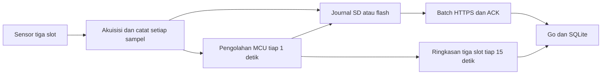

# TSD SIGAP ESP32 S3 dan Arsip Telemetri Seluruh Sampel

Versi 1.0 · 30 September 2026 · Rancangan teknis, belum implementasi

Dokumen ini menjabarkan [PRD Firmware SIGAP ESP32 S3 dengan PlatformIO v1.4](PRD_Firmware_SIGAP_ESP32S3_PlatformIO.md) menjadi rancangan firmware, protokol pengiriman, dan perubahan backend. Satu ESP32-S3 DevKitC-1 N16R8 mengakuisisi sensor untuk tiga slot, menjalankan kalibrasi serta fuzzy dan safety lokal, lalu mencatat **setiap sampel yang diperoleh dan setiap hasil per siklus**. Backend Go mengautentikasi, memvalidasi, menyimpan, membaca, dan mengekspor data tersebut tanpa menghitung ulang keputusan perangkat.

TSD ini adalah spesifikasi untuk pekerjaan mendatang. Angka sampling, ukuran record, kapasitas, pin, dan konfigurasi build mengikuti profil awal PRD; semuanya harus diuji dengan modul dan revisi PCB nyata sebelum dinyatakan siap produksi. Tidak ada firmware, endpoint, migrasi, atau hasil uji hardware yang dinyatakan sudah dibuat oleh dokumen ini.

## 1 Batas sistem dan keputusan arsitektur

| Area | Keputusan teknis | Batas dan sumber keputusan |
| --- | --- | --- |
| Controller | Satu ESP32-S3 N16R8 untuk organik, anorganik, B3; C++ dan Arduino pada PlatformIO. | PRD §§3–8; profil memori/pin diperiksa pada board aktual. |
| Pengolahan | Filter, konversi, normalisasi, FIS Mamdani, verified-empty, dan safety B3 dieksekusi di MCU. | Model numerik produksi masih perlu validasi ilmiah. |
| Akuisisi | Seluruh frame/sampel dari semua sensor dicatat, termasuk kualitas invalid dan trial kalibrasi. | Tidak ada sampling selektif karena jaringan, hasil filter, atau ringkasan. |
| Penyimpanan | microSD menjadi logger utama bila sehat, LittleFS menjadi fallback; record dan batch pending immutable sampai ACK server. | SD opsional secara hardware, kapasitas offline panjang bergantung pada kartu teruji. |
| Transport | HTTPS/Wi-Fi P0; ringkasan v2 pada `POST /api/ingest`, arsip lengkap v3 pada endpoint batch baru. | BLE gateway P1 setelah spike; gateway receipt bukan ACK server. |
| Backend | Go `net/http` dan SQLite dalam repo; migrasi menambah arsip record serta receipt batch. | Tidak menjalankan FIS, kompensasi, normalisasi, atau safety untuk data hardware v2/v3. |
| Antarmuka | Dashboard tetap membaca status terbaru dengan usia data; riset/ekspor membaca seluruh record secara bertahap. | Prioritas current memakai waktu ukur tepercaya; data UTC-null tetap dapat ditelusuri. |



**Invarian:** `acquired` berarti driver benar-benar memperoleh frame atau mencatat attempt yang gagal; `durable` berarti record lolos batas flush/checkpoint yang didefinisikan logger; `server_acked` berarti backend menyimpan record dan receipt secara transaksional serta ACK tervalidasi di perangkat. Ketiga counter berbeda. `acquired > durable` memerlukan gap/fault yang terlihat; record pending tidak dihapus hanya karena sambungan radio berhasil. Pada kehilangan daya mendadak, kemungkinan tail yang belum durable harus diukur dan dilaporkan, bukan disembunyikan sebagai keberhasilan.

## 2 Kesesuaian repo dan tata letak pekerjaan

Landasan historis PRD adalah `RayaSatriatama/IoT-Trashcan` branch `main` commit `6fed00f02b6ef7dabc159d924f798d344a6072ba`. Pada snapshot itu runtime menggunakan Go `net/http`, SQLite, dan Expo Web; belum ada proyek PlatformIO. Reconciliation terhadap HEAD saat dokumen ini diperbarui dilakukan pada `ad65d5fe73c30b16c61da917eb517cdf2a783ba6`, tiga commit di atas baseline.

| Commit | Dampak terhadap pekerjaan firmware | Keputusan reconciliation |
| --- | --- | --- |
| `98e4439` | Runtime dan schema berubah pada ingest, fuzzy, safety, history, read API, simulator, serta research trace. | Jadikan kontrak runtime saat ini; pertahankan endpoint dan evidence yang sudah ada. |
| `292aa47` | PRD/TSD PlatformIO ditambahkan setelah perubahan runtime. | Dokumen ini diperbarui agar baseline historis dan target HEAD tidak tertukar. |
| `ad65d5f` | Menambahkan skill dan tooling proyek; tidak mengubah runtime atau schema. | Catat sebagai konteks tooling tanpa dampak firmware/API. |

Nama file di bawah adalah rancangan target, bukan pernyataan bahwa komponennya sudah ada. Sebelum implementasi, cek ulang `main`, migrasi, route, dan DTO pada commit yang akan menjadi HEAD implementasi. Jangan menimpa perubahan yang sudah ada.

```text
firmware/
  platformio.ini
  partitions_n16r8.csv
  include/board_pins.h, device_config.h
  src/main.cpp
  lib/sensors/{hx711,ultrasonic,mq_adc,ds18b20,sht31}/
  lib/heater/, calibration/, processing/, fuzzy/, safety/, models/
  lib/storage/{record_codec,segment,journal,sd_backend,flash_backend}/
  lib/telemetry/{batch_builder,http_client,ack_validator}/
  lib/runtime/{scheduler,timebase,health,usb_maintenance}/
  test/{native,contract,target}/
  README.md
internal/ingest/{model,validation,service}.go
internal/http/{ingest_handler,telemetry_batch_handler,read_api,history_api}.go
migrations/005_telemetry_archive.sql
docs/firmware/{TSD,contract,calibration,hardware_evidence}
```

Pada HEAD reconciliation, migrasi terakhir adalah `004_device_research_trace.sql`.
Migrator mengurutkan seluruh SQL secara leksikografis, sehingga `005_telemetry_archive.sql`
adalah nama berikutnya yang diharapkan saat ini. Nomor tersebut harus diverifikasi
lagi pada PR implementasi; jika migrasi lain masuk lebih dahulu, gunakan nomor
terurut berikutnya yang masih kosong.

History dashboard saat ini memakai cursor `(recorded_at, reading_id)`. Arsip
telemetry memakai identitas stabil `(device_id, boot_id, sequence)` dan menerima
UTC-null. DTO, query, dan ekspor arsip harus bersifat additive tanpa mengubah
urutan history dashboard atau kolom CSV yang sudah digunakan.

`firmware/` adalah batas kompilasi MCU. `lib/` menerima data dan interface melalui dependency injection sederhana agar logika dapat diuji native tanpa board. Tidak ada driver yang memanggil SQLite atau HTTP. Backend memproyeksikan data masuk ke tabel indeks tanpa mengubah angka edge. Komponen web menggunakan API, bukan membaca file media MCU langsung.

## 3 Profil board, pin, daya dan build

Gunakan profil PlatformIO dari PRD: `espressif32@7.1.3`, `esp32-s3-devkitc-1`, framework Arduino, `board_upload.flash_size = 16MB`, `board_build.flash_mode = qio`, `board_build.arduino.memory_type = qio_opi`, `board_build.psram_type = opi`, filesystem LittleFS, serta env `sigap_n16r8`, `sigap_n16r8_sd`, `sigap_bench`, dan `native`. Dependency sensor/JSON **baru dipin sesudah spike compile** pada versi platform tersebut; jangan mengasumsikan API Arduino 3.x. Konfigurasi ini menurunkan PRD, belum bukti bahwa setiap board berlabel N16R8 memakai topologi memori yang sama.

Partisi awal mengikuti PRD: `nvs` offset `0x9000` ukuran `0x5000`, `phy_init` `0xe000`/`0x1000`, `factory` `0x10000`/`0x400000`, dan `spiffs` `0x410000`/`0x800000` yang dipasang sebagai LittleFS. File manifest/profil besar berada di filesystem, NVS memuat pointer versi aktif dan data konfigurasi kecil. Lakukan cek batas ukuran image, konflik partisi, kapasitas NVS, ruang kerja model, serta mounting FS pada target sebelum freeze; konfigurasi tanpa OTA.

| Perangkat | Slot | GPIO pada profil awal |
| --- | --- | --- |
| MQ-4, MQ-135, MQ-7, MQ-8 melalui divider ADC1 | Organik, organik, B3, B3 | 4, 5, 6, 7 |
| HX711 DOUT/SCK | Organik; anorganik; B3 | 10/11; 12/13; 14/15 |
| Ultrasonic TRIG/ECHO | Organik; anorganik; B3 | 16/17; 18/21; 47/42 |
| DS18B20 1-Wire; MQ-7 heater select | B3 | 2; 1 |
| SHT31 SDA/SCL, alamat `0x44`/`0x45` | Organik; B3 | 8/9 bersama |
| microSD SPI SCK/MISO/MOSI/CS | Opsional | 39/40/41/43 |

Pin 43 untuk CS mengambil fungsi UART0 TX pada DevKitC; maintenance menggunakan USB native. Jangan memakai pin strapping 0/3/45/46, pin memori 26–37, USB 19/20, atau 38/48 yang dapat berbenturan dengan RGB menurut revisi board. Periksa header, schematic, level logic, dan kondisi CS/heater saat reset. GPIO 39–42 dipakai sehingga rencana debug tidak boleh bergantung pada JTAG eksternal. Seluruh GPIO digital menerima level 3,3 V: ECHO 5 V dan keluaran analog MQ melalui divider; heater MQ tidak mengambil arus dari GPIO. Tegangan fase MQ-7 berasal dari datasheet modul yang benar-benar dipasang, sedangkan contoh 5 V/60 s dan 1,5 V/90 s pada PRD hanya berlaku untuk profil contoh MQ-7B.

## 4 Kontrak internal record dan waktu

Semua jenis record berbagi envelope semantik. Serialisasi transport boleh JSON, sedangkan segmen lokal boleh memakai representasi biner berframing selama nilai asli dan byte batch yang dikirim dapat dipertahankan tepat. Schema v3 dikelola sebagai fixture bersama C++/Go. Unit, nullability, rentang, enum, max length dan versi wajib didefinisikan per field dalam kontrak final.

| Field | Aturan |
| --- | --- |
| `device_id`, `boot_id`, `sequence`, `record_id` | Device code hasil provisioning, boot ID acak unik per boot, sequence uint64 per boot; record ID = gabungan tiga komponen. Alokasikan sequence untuk sample, result, event, dan metadata dari satu sumber. |
| `kind`, `sensor_id`, `stream` | `sample`, `result`, `event`, `metadata`; sensor/slot harus dikenal pada profil board dan schema. |
| `monotonic_us`, `recorded_at`, `time_quality` | Waktu monotonic diambil sedekat mungkin dengan akuisisi; UTC string RFC3339 atau null; quality `SYNCED`, `RECONSTRUCTED`, `UNSYNCED` dengan uncertainty/anchor jika ada. |
| `raw`, `converted`, `quality`, `reason` | Raw sesuai protokol sensor; hasil konversi hanya jika valid; quality/reason menjelaskan validitas tanpa membuat nilai palsu. |
| `profile_refs` | Versi/hash sampling, kalibrasi, kapasitas, FIS, safety serta firmware yang berlaku pada record. Manifest lengkap diarsipkan secara terpisah berdasarkan hash. |
| `source_sample_ids` | Hasil satu siklus memuat semua record ID sampel yang berkontribusi pada setiap filter/input. Nilai daftar tidak boleh dipotong untuk menyesuaikan body. |

**Representasi uint64 JSON:** sequence diserialisasi sebagai string desimal (misalnya `"901"`) dalam rancangan final agar consumer JavaScript tidak kehilangan presisi di atas `2^53−1`. Parser Go memeriksa string digit, overflow uint64, dan kesinambungan identitas. Contoh angka JSON dalam PRD adalah ilustrasi dan perlu diselaraskan dengan fixture kontrak v3 sebelum implementasi. `boot_id` berasal dari sumber random perangkat yang diuji, tidak bergantung pada NTP atau MAC saja. Record ID persisten sudah dialokasikan sebelum append; counter global tidak direkonstruksi dari UTC.

Clock anchor adalah event append-only `{boot_id, monotonic_us, utc, uncertainty_us, source}`. Sinkronisasi NTP berikutnya menambahkan anchor baru, termasuk bila jam dikoreksi mundur; tidak menulis ulang `recorded_at` pada record lama. Query boleh menghitung `derived_at` dan provenance anchor sebagai kolom baca terpisah. Boot yang tidak pernah memperoleh anchor tetap UTC-null; backend menerima dan mengekspornya. Ringkasan legacy dibuat untuk `POST /api/ingest` saat UTC tepercaya tersedia; cold boot tanpa UTC tetap mengarsip semua sample/result, kemudian mengirim ringkasan baru setelah sinkronisasi. Ringkasan tidak mewakili jumlah arsip.

## 5 Akuisisi sensor dan penjadwalan

Target sampling awal PRD menghasilkan 75 frame sensor/s dan tiga result/s: tiga HX711 ×10 SPS =30, empat MQ ×10 Hz =40, tiga ultrasonic ×1 Hz =3, satu DS18B20 ×1 Hz =1, dua SHT31 ×0,5 Hz =1 frame/s. Satu frame SHT31 berisi suhu dan RH sekaligus, sehingga keduanya tersedia tanpa menghitung frame dua kali. Laju di dalam profil bersifat eksplisit dan perubahannya menambah event versi baru. Sampling tetap berlangsung saat Wi-Fi tidak ada; tidak ada penurunan laju tersembunyi. Varian HX711 80 SPS harus melalui perhitungan CPU, logger, SD dan backend ulang.

| Driver | Frame yang dicatat | Penanganan operasi |
| --- | --- | --- |
| HX711 ×3 | Signed counts dari setiap data ready, gain/channel, slot, mode 10/80 SPS, waktu dan quality. | Baca saat ready dengan timeout; tare/faktor berlaku per slot. Pengukuran negatif besar tetap ada di raw meski hasil kg null. |
| Ultrasonic ×3 | Trigger ID, lebar pulsa ECHO us bila ada, timeout/range, waktu. | Trigger bergantian; gap awal 60 ms dan timeout awal 30 ms dari PRD sampai model diketahui. ISR/RMT dipilih setelah spike kompatibilitas. |
| MQ-4/135/7/8 | ADC counts setiap 100 ms per kanal, mV bila kalibrasi ADC sah, divider, state heater, quality. | Fase MQ-7 `HIGH_CLEAN` tetap mempunyai sampel raw dengan hasil gas operasional null. Jangan mengklaim ppm/OGI tanpa profil ilmiah. |
| DS18B20 | ROM, scratchpad byte, CRC, konversi selesai, suhu bila sah. | Request nonblocking; pada 12 bit izinkan waktu konversi hingga 750 ms menurut profil awal. Jangan perlakukan power-on 85 °C sebelum conversion valid sebagai suhu. |
| SHT31 ×2 | Raw word/frame termasuk CRC untuk `0x44` dan `0x45`, suhu dan RH jika valid. | Bus I2C satu pemilik; CRC/timeout per alamat. Satu sensor gagal tidak menghentikan alamat lain. |

Akuisisi memakai scheduler monotonic dan deadline per kanal. Task sensor menjadi pemilik tunggal driver dan bus I2C; transfer record ke logger melalui antrean RAM bounded dengan indikator high-water dan overrun. Result worker memperoleh snapshot immutable keadaan sensor pada batas siklus 1 detik, termasuk ID jendela raw yang dipakai filter. Storage dan HTTPS tidak berjalan di critical timing path. Serial maintenance tidak memblokir akuisisi. Watchdog menilai progres akuisisi, logger, dan worker berdasarkan heartbeat serta deadline nyata; konfigurasi task/stack/queue dibekukan setelah pengukuran heap, PSRAM dan tail latency, bukan angka spekulatif di dokumen ini.

Jika buffer penuh, jangan diam-diam overwrite sampel; tingkatkan `unlogged_records` dan event gap dengan rentang sequence, sensor, alasan, serta waktu. Attempt sensor yang gagal membuat sample record `raw:null` dengan quality `TIMEOUT`, `CRC_ERROR` atau `DISCONNECTED` dan byte parsial yang benar-benar didapat bila ada. `STALE` berlaku pada pemilihan input pengolahan dan tidak mengubah sample historis menjadi pembacaan baru.

## 6 Pengolahan lokal per detik

Pipeline setiap slot berurutan: pilih sampel dalam jendela dan cek age/quality → simpan daftar `source_sample_ids` → filter/konversi menggunakan profil aktif → normalisasi input berdasar kapasitas slot → evaluasi FIS sesuai manifest → evaluasi safety B3 terpisah → bentuk result record walaupun hasil invalid → serahkan ke logger. Perubahan model/kalibrasi memakai pointer manifest yang difreeze pada awal siklus agar satu record tidak mencampur dua versi. Hasil dikirim setelah durable, tidak dihitung ulang pada replay.

Fill memakai `100 × (D_empty − D_measured)/(D_empty − D_full)` dengan syarat `D_empty > D_full`; overshoot kecil hanya di-clamp menurut tolerance terkalibrasi. Berat memakai offset tare dan counts/kg per slot; `weight_utilization_pct = 100 × weight_kg/operational_capacity_kg`. Capacity kg berasal dari mekanik, bukan otomatis rating load cell 20 kg. Input invalid menghasilkan null dan reason. Accumulation berasal dari `last_verified_empty` per slot, dengan hysteresis/stability dari profil ilmiah; kalibrasi atau reboot tidak membuat event kosong otomatis. Jika durasi lintas boot tidak diketahui karena UTC belum valid, hasil durasi null.

### FIS Mamdani yang dapat diaudit

Manifest FIS menentukan input wajib beserta unit/domain, urutan himpunan, fungsi tri/trap, daftar rule ber-ID stabil, operator `AND=min` dan `OR=max`, clipping `min`, agregasi `max`, grid/resolusi centroid, epsilon area, threshold label, serta `fis_version`/hash. Runtime menolak parameter non-finite, shoulder tidak valid, rule coverage yang tidak lengkap, overflow ukuran trace, dan domain yang tak cocok. Area nol, input hilang/stale/CALIBRATING, atau model rusak menghasilkan `score:null`, `state:UNAVAILABLE`/`UNCONFIGURED`, dan alasan yang dicatat. Fallback ke profil dua input hanya bila diaktifkan eksplisit dan mempunyai identitas model berbeda.

Profil dua input bench `TEST_ONLY` dari PRD memakai fill dan weight utilization masing-masing `trap[0,0,30,50]`, `tri[30,50,70]`, `trap[50,70,100,100]`; output mempunyai bentuk yang sama. Matriks rule: fill rendah terhadap berat rendah/sedang/tinggi menghasilkan Normal/Waspada/Angkat; fill sedang menghasilkan Waspada/Waspada/Angkat; fill tinggi menghasilkan Angkat/Angkat/Angkat. Label bench: `<40` Normal, `40..<70` Waspada, `≥70` Angkat. Pada `(40,40)`, membership kedua input `[0,5;0,5;0]` dan rule 1, 2, 4, 5 masing-masing strength `0,5`; centroid kontinu referensi `1270/39 ≈ 32,56`, dengan tolerance diskret dari manifest. Angka ini adalah fixture matematis untuk engine, bukan keputusan produksi atau hasil MCU.

Simpan seluruh membership yang dipakai, semua rule aktif ID/strength, bentuk atau ID output teragregasi, area/centroid, skor, label, state, reason, serta version/hash. OGI, batas waktu, bobot gas, threshold dan hysteresis safety B3 tetap kosong sampai diuji; model production tidak boleh diaktifkan hanya karena fixture bench lulus. Safety B3 mempunyai manifest dan state terpisah; input hazard invalid → `UNAVAILABLE`/`FAULT`, bukan `CLEAR`. Alert yang latch hanya dilepas menurut aturan clear tervalidasi, tanpa terpengaruh skor collection rendah.

## 7 Kalibrasi dan aktivasi profil

Maintenance memakai USB native lokal dalam kondisi tanpa Wi-Fi dan tanpa SD. State per target: `IDLE → CAPTURE → VALIDATE → PREVIEW → COMMIT` atau `CANCEL/FAILED`. Target selalu menyimpan trial raw, menampilkan nilai/variansi dan reason, serta membuat input operasional target `CALIBRATING`; sensor lain, heater dan hasil tiga slot tetap berjalan. Variasi/anchor yang diterima bergantung pada jenis sensor serta nilai referensi yang ditetapkan teknisi, bukan threshold generik yang disembunyikan.

| Target | Isi draft dan pemeriksaan sebelum commit |
| --- | --- |
| HX711 slot | Counts tare stabil, beban referensi positif, counts/kg finite dan nonzero, arah, deadband. |
| Jarak slot | `D_empty`, `D_full`, model/mounting, tolerance; `D_empty > D_full` dalam rentang sensor. |
| MQ ×4 | Baseline raw dan profil ADC/divider, heater phase; `R0` hanya dengan referensi sah; tidak otomatis memberi ppm. |
| DS18B20/SHT31 | ROM/alamat, CRC, referensi yang dicatat, offset opsional bila bukti mendukung. |

Profil berisi schema, target sensor, versi, koefisien dengan unit, reference note, `boot_id`/monotonic, UTC atau null, checksum/hash. Commit menyimpan file draft lengkap, validasi readback, lalu mengganti pointer aktif atomik dalam NVS; profil lama tetap tersedia untuk rollback. Jika power loss, pointer menunjuk profil lama atau baru yang utuh. Draft hilang pada cancel/timeout/reboot. Impor menolak schema/identity/hash salah; ekspor profil tidak memuat token atau kata sandi. Untuk model FIS/safety, gunakan dua slot file flash dan pointer NVS dengan validasi yang setara. Metadata perubahan masuk arsip record; record pending memakai versi pada saat dihasilkan.

## 8 Logger, media dan pengendalian ruang

Satu `record_codec` menetapkan framing segmen: magic/version, panjang terbatasi, record ID/jenis, checksum, payload, dan commit marker/checkpoint. Pilihan CRC/checksum tingkat segmen mendeteksi korupsi I/O; hash kriptografis konten dipakai untuk dedupe backend. Format byte, endianness dan versi disimpan dalam fixture, sehingga recovery lintas upgrade dapat diuji. Segmen append diputar pada usulan 64 MiB maksimum di SD; flash memakai segmen lebih kecil menurut wear/kapasitas yang diuji. Rebuild index dari record utuh dan journal ACK pada boot; tail parsial dikarantina dan dihitung sebagai kemungkinan kehilangan dengan alasan.

State media: `SD_HEALTHY` menulis langsung ke SD; `SD_FAILED/ABSENT/FULL` beralih ke LittleFS tanpa menghapus pending SD; `RECOVERING` menggabungkan index ID dan ACK; `LOGGING_BLOCKED` terjadi jika seluruh quota tidak dapat menerima record baru. Memasukkan kartu tidak otomatis memformatnya. Eject melakukan flush dan checkpoint; hot removal memicu fault. Migrasi flash → SD menggunakan copy, verify, checkpoint, kemudian reclaim flash; pada crash, dedupe record ID mencegah record ganda. Pending tetap immutable sampai server ACK, sedangkan kebijakan retention data yang sudah delivered harus diputuskan tersendiri.

Batch JSON yang sudah dikirim atau sedang retry dan manifest ID/hash disimpan durable sebagai unit immutable. Worker boleh mengemas record menjadi batch baru **sebelum percobaan pengiriman pertama**. Sesudah batch ID/body_hash ditetapkan, retry apa pun menggunakan body yang sama. Dedupe record lintas batch memungkinkan recovery saat batch baru harus dibentuk setelah fault, tanpa memodifikasi batch yang sudah pernah dikirim. ACK yang rusak, timeout, 409, atau upload ke gateway tanpa ACK server tidak memajukan journal delivered. Ruang untuk journal dan gap metadata disisihkan di luar pending quota. Jika ruang metadata itu pun gagal, counter RAM/NVS terakhir dan status fault mencatat keterbatasan keterlacakan; jangan mengklaim histori penuh ketika media fisik tidak dapat menulis.

| Anggaran awal PRD | Nilai | Penafsiran |
| --- | --- | --- |
| Sensor + result | 75 + 3 record/s | Sekitar 6.480.000 raw dan 259.200 result/hari. |
| Ukuran perkiraan | Raw 256–512 B; result 1–4 KiB; ringkasan 8 KiB/15 s | Belum ukuran JSON nyata dan belum termasuk overhead SQLite. |
| Total perkiraan | 22,3–50,0 KiB/s; 1,84–4,12 GiB/hari | Laju writes serta upload harus diukur dengan trace terburuk. |
| Flash 8 MiB LittleFS | Usulan pending 6 MiB, 2 MiB untuk manifest/model/overhead | Target konservatif semua sampel minimal 60 detik tanpa SD; ukur ruang usable. |
| SDHC 32 GB FAT32 opsional | Usulan pending 20 GiB plus workspace | 72 jam diperkirakan 5,51–12,37 GiB; dengan cadangan 50% 8,26–18,55 GiB. |
| Drain Wi-Fi | Usulan throughput sustained ≥100 KiB/s | Harus diuji saat acquisition, FIS, logger dan TLS berjalan bersamaan. |

Saat quota habis, **jangan overwrite pending tertua**. Operator melihat `LOGGING_BLOCKED`, jumlah `unlogged_records`, rentang ID yang tidak terekam, sebab, usia pending, serta kanal yang terkena. Produk dapat terus menghitung lokal tetapi tidak boleh melaporkan bahwa data tersebut sudah tersimpan. Ukur p99 latency append/flush, high-water antrean, tail loss pada pemutusan daya, wear flash, serta throughput SD dan SQLite dengan data worst case sebelum menetapkan durasi nyata.

## 9 Kontrak HTTPS dan transaksi backend

### Ringkasan v2

`POST /api/ingest` tetap menjadi route summary-v2. Route ini tetap menerima `device_id`, `recorded_at` UTC, `slots` tepat `organic`, `inorganic`, `b3`, dan `health` sesuai kontrak repo. Serialisasi sekali, simpan byte untuk replay exact karena baseline menganggap payload yang berubah pada waktu sama sebagai konflik. `health.sensors` menunjukkan pembacaan terbaru tiap kanal, `health.edge_results` menunjukkan hasil terbaru tiga slot termasuk reason/versi, dan counter logger. Body target 8 KiB adalah usulan yang wajib diverifikasi. ACK `readings_stored=3` hanya menyatakan ringkasan tersimpan, sehingga tidak menghapus arsip lengkap. `gas_raw` scalar boleh null; kanal MQ disimpan terpisah.

### Arsip v3

Rencanakan `POST /api/telemetry/batches` dengan Bearer device token, `Content-Type: application/json`, body awal maksimum 32 KiB, satu record awal maksimum 16 KiB. JSON request dibatasi nested depth, jumlah array, panjang string, enum, ukuran, finite numeric dan identitas device. Payload memuat `schema_version:3`, `device_id`, `batch_id`, `samples[]`, `results[]`, `events[]`, `metadata[]`, `record_count` dan manifest daftar ID. `body_hash` dihitung dari byte body persis yang dikirim dan dipersist sebagai metadata di luar body agar tidak membuat hash diri sendiri. Semua record mempunyai ID unik; urutan di array tidak menjadi urutan sampling global, sehingga query memakai `(boot_id, sequence)`.

Contoh ringkas **proposal kontrak**, bukan paket siap dikirim; fixture resmi wajib menambahkan provenance versi/hash dan data sensor spesifik lengkap:

```json
{
  "schema_version": 3,
  "device_id": "SIGAP-01",
  "batch_id": "SIGAP-01/boot-X/batch-12",
  "record_count": 2,
  "manifest_ids": ["SIGAP-01/boot-X/880", "SIGAP-01/boot-X/901"],
  "samples": [{
    "record_id": "SIGAP-01/boot-X/880",
    "kind": "sample", "boot_id": "boot-X", "sequence": "880",
    "sensor_id": "mq4", "stream": "organic", "monotonic_us": "1800000000",
    "recorded_at": null, "time_quality": "UNSYNCED",
    "raw": {"adc_counts": 1234}, "quality": "WARMING_UP"
  }],
  "results": [{
    "record_id": "SIGAP-01/boot-X/901",
    "kind": "result", "boot_id": "boot-X", "sequence": "901",
    "stream": "organic", "computed_monotonic_us": "1800000100",
    "source_sample_ids": ["SIGAP-01/boot-X/880"],
    "processed": {"fill_pct": null, "weight_kg": null, "ogi": null},
    "fuzzy": {"state": "UNAVAILABLE", "score": null,
              "reason": "INPUT_MISSING", "model_state": "TEST_ONLY"}
  }],
  "events": [], "metadata": []
}
```

Kedua record ilustratif menunjukkan sampel gas organik yang tetap dicatat saat `WARMING_UP` dan hasil organik unavailable karena input wajib lain belum ada. Fixture integrasi harus berisi `source_sample_ids` sesungguhnya untuk seluruh jendela, semua input, trace fuzzy, quality, unit dan versi. Contoh di PRD mempunyai sequence berbentuk JSON number, sementara kontrak ini mengusulkan string desimal untuk presisi lintas JavaScript. Saat freeze schema, contoh PRD dan TSD harus diseragamkan.

Respons sukses yang direncanakan:

```json
{
  "device_id": "SIGAP-01", "batch_id": "SIGAP-01/boot-X/batch-12",
  "body_hash": "sha256:<hex-of-exact-request-bytes>",
  "record_count": 2, "stored_count": 2,
  "deduplicated_count": 0, "status": "DURABLE"
}
```

Perangkat memverifikasi `device_id`, `batch_id`, `body_hash`, `record_count`, dan `stored_count + deduplicated_count == record_count` sebelum meng-ACK jurnal lokal. Backend memulai transaksi SQLite, memastikan token berlaku bagi device, memeriksa schema/manifes/hash per record, lalu `INSERT` record atau menerima duplikat identik. `UNIQUE(device_id, record_id)` mencegah duplikasi; konflik hash/isi memberi `409` dan membatalkan **seluruh batch**. Tabel receipt batch mengikat `(device_id,batch_id)` ke hash/count/ID; ID batch yang sama dengan body berbeda memberi `409`. Commit record+receipt selesai sebelum HTTP 200. Jika proses mati setelah commit tetapi sebelum respons, retry memperoleh ACK identik. Backend tidak membentuk skor/status pengganti dan tidak menghapus nilai raw invalid yang secara struktur sah.

| Status | Kebijakan perangkat |
| --- | --- |
| `200` dengan ACK valid | Journal record delivered; batch reclaim setelah checkpoint. |
| Timeout, `429`, `5xx` | Pertahankan batch byte-identik; backoff 1–60 s + jitter sesuai profil dan `Retry-After`. |
| `401`, `403` | `AUTH_ERROR`, pending dipertahankan; tindakan operator melalui USB. |
| `400`, `404`, `409`, `415` | Catat fault/quarantine manifest tanpa menghapus record. Diagnostik menunjukkan ID dan alasan, tanpa secret. |
| Respons malformed/hash/count berbeda | `PROTOCOL_ERROR`; tidak ACK lokal. |

TLS memvalidasi CA dan hostname. Wi-Fi RSSI hanya diagnostik. Prioritas pengiriman ringkasan terbaru boleh mendahului drain arsip, namun worker harus menyediakan waktu unggah berkelanjutan bagi backlog dan tidak memblokir akuisisi. BLE P1 memakai fragmentasi beserta batch ID, indeks/total, checksum dan body identik; gateway meneruskan ACK backend yang telah diverifikasi dan tidak memiliki kewenangan menghapus journal berdasarkan receipt lokal saja.

## 10 Rancangan penyimpanan SQLite dan API baca

Migrasi baru mempertahankan tabel dan endpoint lama. Tabel logis berikut dapat diterapkan sebagai beberapa tabel typed atau JSON+index sesuai benchmark, dengan constraint yang sama. Seluruh isi raw dan trace perlu tersedia tanpa mereplikasi envelope besar per slot.

| Tabel logis | Kunci, payload, dan indeks minimum |
| --- | --- |
| `telemetry_records` | `device_id`, `record_id` unik; `kind`, `sensor_id`, `stream`, `boot_id`, `sequence_decimal`, `monotonic_us`, `recorded_at` nullable, quality, `record_hash`, `raw_payload`, `received_at`. Indeks `(device_id,boot_id,sequence)`, `(device_id,sensor_id,received_at)`, dan waktu ukur bila ada. |
| `batch_receipts` | `(device_id,batch_id)` unik; exact body hash, count, canonical list/hash ID, committed_at. Isi respons replay tetap sama. |
| `profile_manifests` | `(device_id,kind,version,hash)` unik; kalibrasi, sampling, FIS, safety, kapasitas beserta provenance. Missing manifest tidak menghalangi raw record. |
| `clock_anchors` | Event record ID, boot ID, monotonic, UTC, uncertainty; query membentuk `derived_at` tanpa rewrite raw. |
| `current_projection` | Materialisasi optional untuk latest per slot dengan source/time quality; tidak mengganti raw dan tidak menerima backlog lebih tua sebagai current. |

Simpan checksum/hash record terhadap representasi kanonik yang distandarkan (misalnya serializer fixture v3 dengan urutan field tetap); backend tetap menyimpan byte permintaan asal atau per-record raw payload untuk audit. Canonical hash record diperlukan agar duplikat identik yang datang pada batch berbeda dianggap sama walaupun posisi array berbeda. Hash batch tetap berasal dari byte request persis. Definisikan secara eksplisit JSON number normalization, Unicode, urutan key, dan null vs absent dalam fixture lintas bahasa sebelum implementasi; jangan mengandalkan hasil serializer berbeda sebagai ukuran kesamaan diam-diam.

`internal/ingest/service.go` untuk hardware v2/v3 hanya memvalidasi dan menyimpan hasil edge. Uji memastikan fungsi Normalize/evaluator legacy tidak dipanggil pada jalur tersebut. Simulator/legacy diberi source terpisah, tanpa menimpa hasil ESP32. API research dan ekspor menyediakan cursor atau pagination stabil `(device_id,boot_id,sequence)` dan filter sensor/stream/kind/quality/UTC-null; ekspor besar memakai streaming serta metadata time anchor/versi. Backend mengembalikan `recorded_at:null` sebagaimana asal dan `derived_at` secara terpisah bila tersedia. Metrik SQLite meliputi disk/day, WAL, latency commit, throughput ingest, index growth, query/export, backup dan retensi yang disetujui. Jalur batch baru harus additive, tidak mengubah `POST /api/ingest`, serta tidak menimpa `trace_json` atau `safety_json` yang ditambahkan migrasi `004`; nomor migrasi dan nama fungsi final diverifikasi ulang terhadap HEAD repo saat eksekusi.

## 11 Observabilitas, keamanan dan kegagalan

`health` dan maintenance USB menampilkan mode device, versi firmware/kalibrasi/model, readiness sensor per kanal, state heater, state SD/flash, waktu/uncertainty, koneksi, antrean, `acquired/durable/server_acked` per sensor dan result, overrun, gap ranges, storage used/free, oldest pending, last server ACK, dan reset reason. `LOGGING_BLOCKED` tetap menonjol walau FIS masih menghitung. Status model TEST_ONLY/UNCONFIGURED dibedakan dari Normal dan `SAFETY_UNAVAILABLE` tidak tampil sebagai aman.

Secret Wi-Fi dan Bearer token diprovision melalui USB, disimpan pada penyimpanan konfigurasi yang sesuai, tidak dicetak kembali, dan tidak masuk batch, health, ekspor, file profil, repo, atau log diagnostik. Operasi kalibrasi dan impor profil hanya dari maintenance lokal; validasi ukuran/checksum/versi dilakukan sebelum pointer aktif berpindah. Pada backend, token dicocokkan ke `device_code`, device A tidak dapat mengirim record milik device B, dan file ekspor tidak memuat credential. Rencana autentikasi USB fisik serta prosedur operasional penggantian token dicatat pada SOP pilot.

| Kegagalan | Perilaku yang dirancang |
| --- | --- |
| Sensor gagal atau CRC salah | Raw yang benar-benar diterima dan quality tetap dicatat; result terkait null dengan reason; kanal lain lanjut. |
| Koneksi atau TLS gagal | FIS/logger lanjut; batch pending dan body tetap utuh; auth fault terlihat. |
| SD dicabut atau error | Alih ke flash jika tersedia; pending di kartu tetap pending dan dipulihkan saat kartu kembali. |
| Seluruh quota penuh | Pending lama tidak ditimpa; gap baru dan `LOGGING_BLOCKED` tercatat sejauh media metadata memungkinkan. |
| Mati daya saat append/ACK | Recover segmen utuh/checksum dan checkpoint; duplikat upload ditangani backend; tail loss terukur. |
| UTC tidak tersedia | Arsip UTC-null tetap diunggah; anchor berikutnya menambah informasi tanpa mengubah byte historis. |
| Model tidak valid | Result per siklus mempunyai `UNAVAILABLE`/reason; raw tetap utuh; rollback ke profil valid hanya lewat pointer. |

## 12 Verifikasi dan kriteria selesai

Dokumen ini tidak mengklaim hasil uji. Tahapan berikut menghasilkan bukti yang dibutuhkan PRD AC01–AC29; AC19–AC20 berlaku bila varian SD dipilih. Penetapan model produksi tetap menunggu eksperimen serta keputusan pakar.

| Tahap verifikasi | Bukti minimal | Kriteria PRD |
| --- | --- | --- |
| Board/build | Build clean semua env yang disetujui; flash/PSRAM, USB, GPIO, rail, timing heater pada hardware. | AC01–AC03, AC06 |
| Driver/kalibrasi | Fixture per kanal, uji empty/full/beban, CRC, unplug, heater invalid, offline capture/commit/cancel/rollback. | AC04–AC07, AC17–AC18, AC21 |
| FIS/safety | Boundary shoulder, nine-rule fixture `(40,40)`, centroid oracle independen, zero-area, missing input, trace, versi lama saat replay. | AC16, AC22–AC24 |
| Logger | Fixture ber-ID untuk semua sensor dan tiga result/s; acquired/durable/acked/hash/ID cocok; SD fault, quota full, power cut append/checkpoint, ukuran dan wear. | AC08, AC10–AC11, AC19–AC20, AC25–AC26, AC29 |
| Kontrak Go | Body batas, UTC-null, token, transaksi sebelum ACK, replay identik, dedupe lintas batch, konflik ID/body, parser uint64, raw/edge sama persis. | AC08–AC09, AC12–AC14, AC23, AC27–AC28 |
| End-to-end | 24 jam soak, putus Wi-Fi, backlog drain sambil sampling tetap, ekspor seluruh kanal/trace, current tidak mundur, sumber model tercatat. | AC13, AC15, AC19, AC22, AC24–AC29 |

Uji native memverifikasi fungsi murni/record codec dengan oracle terpisah. Tes target MCU mengukur deadline akuisisi, high-water queue, heap/PSRAM, SD sustained write, p99 latency flush dan kehilangan tail. Tes Go mengukur transaksi SQLite/WAL serta paging/ekspor jutaan record, karena angka perkiraan 1,84–4,12 GiB/hari belum memasukkan index/backend. Untuk acceptance kelengkapan, generator sensor memberikan sequence yang diketahui dan verifikator membandingkan set ID serta hash dari akuisisi hingga ekspor; hanya counter total yang sama tidak cukup membuktikan setiap kanal utuh.

### Gate sebelum memulai coding dan sebelum pilot

| Gate | Hal yang harus dikunci atau dibuktikan |
| --- | --- |
| Kontrak v3 | Schema fixture yang sama di firmware/Go, sequence string, hash kanonik, batas body/record, ACK dan error. |
| Hardware | Revisi modul N16R8, model ultrasonic, datasheet MQ-7/modul heater, lokasi SHT31 kedua, power rail dan card socket. |
| Model ilmiah | Membership/rule produksi, OGI, accumulation, verified-empty, hazard B3, threshold/hysteresis dan label pakar. Engine TEST_ONLY dapat diuji tanpa berpura-pura menjadi model produksi. |
| Kapasitas | Ukuran raw/trace per record, p99 flush, 60 detik flash, 72 jam SD pada varian terpasang, sustained Wi-Fi ≥100 KiB/s usulan, serta disk SQLite/retensi. |
| Operasi | TLS dan storage persisten backend, prosedur kalibrasi/provisioning, backup, monitoring gap dan kebijakan data delivered. |

Jika hasil bench melewati batas 16 KiB per record atau 32 KiB per batch, naikkan kontrak dan anggaran memori/HTTP/storage secara eksplisit sebelum model tersebut diaktifkan. Jangan memotong daftar sumber, raw, atau trace. Jika hardware tanpa SD dipilih, komunikasikan durasi flash yang teruji; target 72 jam hanya untuk varian SD yang lolos endurance.

## 13 Urutan pengerjaan yang dapat direview

1. Freeze wiring dan schema v3 beserta fixture semua sensor, hasil, ACK, UTC-null dan hash; reconcile repo HEAD dengan baseline PRD.
2. Buat proyek PlatformIO, partisi, board checks, driver akuisisi, ring buffer bounded, waktu monotonic, record codec serta tes native.
3. Tambahkan maintenance USB, kalibrasi per target, profil/model atomik, pipeline filter/normalisasi, FIS Mamdani, safety dan verified-empty pada MCU.
4. Tambahkan logger SD/flash, journal/recovery/gap metrics, HTTPS ringkasan v2 dan batch v3 dengan byte retry immutable.
5. Tambahkan migrasi dan handler Go untuk arsip record/receipt idempotent, hentikan inference pada jalur hardware, lalu API research/export/dashboard.
6. Jalankan fault injection, uji throughput dan endurance hardware, soak 24 jam, dokumentasikan kalibrasi, wiring, operasi dan hasil acceptance. Uji BLE gateway sebagai jalur P1 terpisah bila dipilih.

Estimasi lama 12–20 hari dalam PRD sebelumnya sudah ditarik; jadwal baru hanya masuk akal setelah profil ukuran record, kartu SD, laju logger, kontrak v3 dan throughput SQLite diuji. Seluruh langkah di atas adalah rencana teknis, belum pekerjaan pada source repo.
