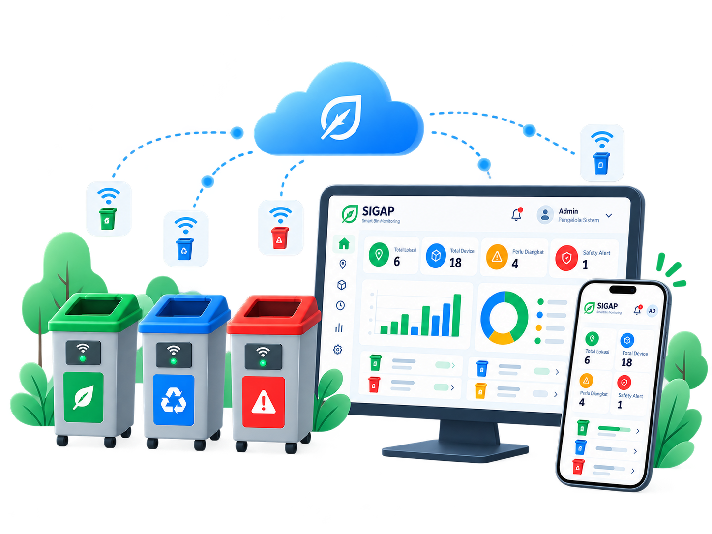
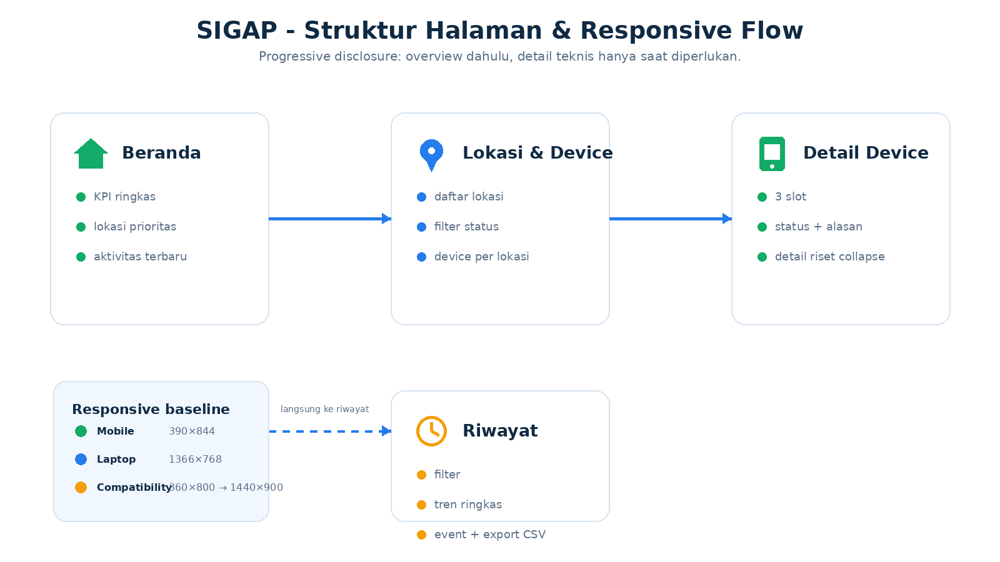
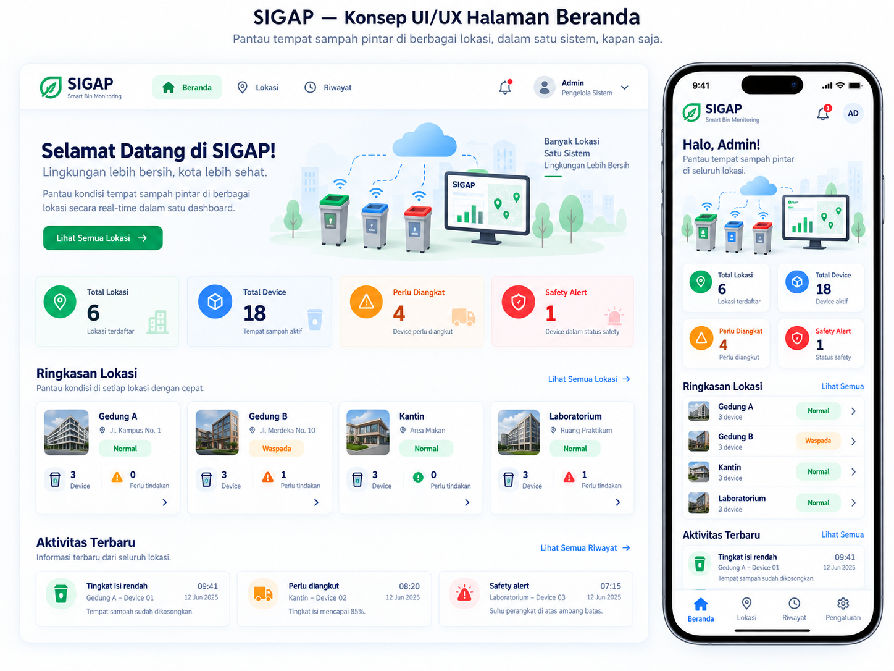
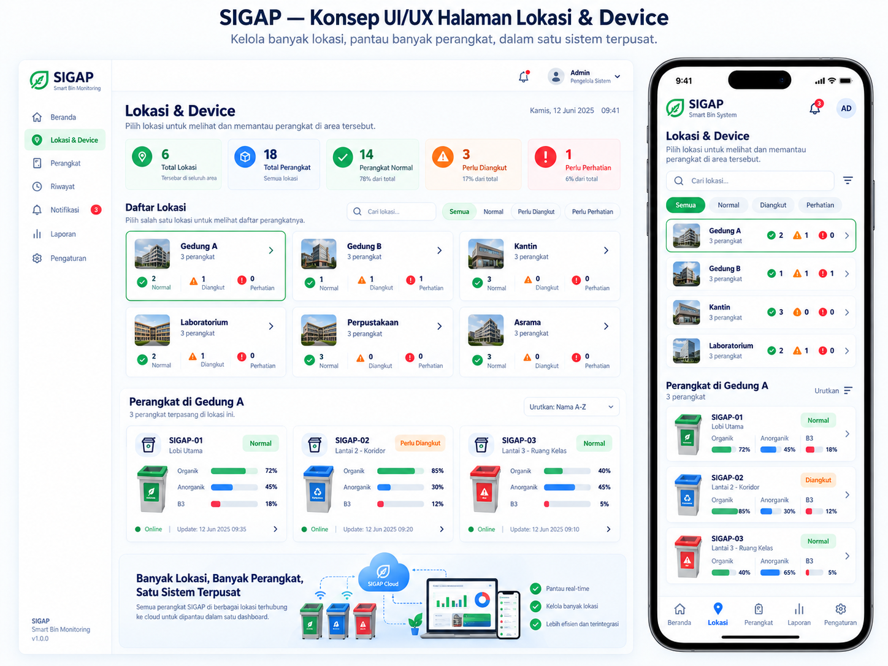
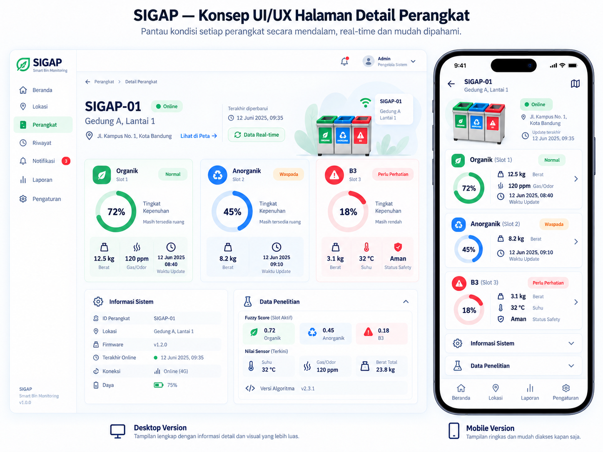
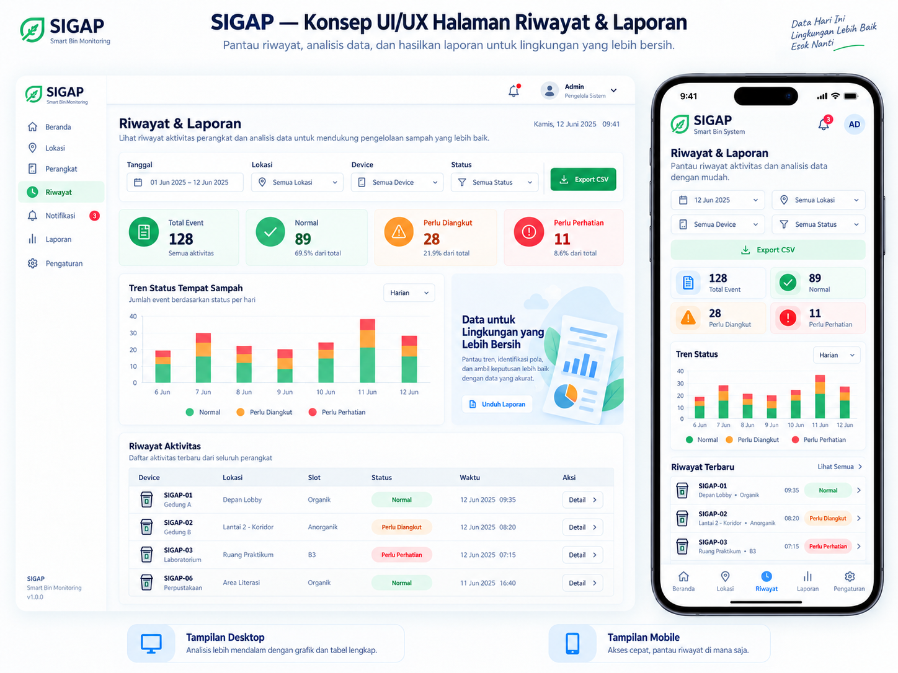

# PRODUCT REQUIREMENTS DOCUMENT

## SIGAP Apps — PRD

Dashboard monitoring smart bin multi-lokasi yang ringan, cepat, tanpa login, dan siap digunakan untuk penelitian.

<table>
<colgroup>
<col style="width: 33%" />
<col style="width: 33%" />
<col style="width: 33%" />
</colgroup>
<thead>
<tr class="header">
<th><strong>Version 
v1.0</strong></th>
<th><strong>Target 
Research-ready MVP</strong></th>
<th><strong>Delivery 
5 hari kerja</strong></th>
</tr>
</thead>
<tbody>
</tbody>
</table>

Dokumen ini sengaja ringkas. Fokusnya adalah keputusan yang langsung dibutuhkan untuk membangun dan menguji MVP dalam 5 hari, bukan proses delivery enterprise yang panjang.

# **1. Ringkasan Produk**

| **Product intent: operator dan peneliti dapat menemukan lokasi/device yang membutuhkan tindakan dalam beberapa detik, tanpa login dan tanpa membuka seluruh data sensor.** |
|----------------------------------------------------------------------------------------------------------------------------------------------------------------------------|

SIGAP Apps adalah dashboard monitoring multi-lokasi dan multi-device. Aplikasi menerima data smart bin, menampilkan hasil Mamdani FIS dan B3 Safety Override, menyediakan riwayat serta ekspor data penelitian, dan berjalan sebagai satu aplikasi produksi yang ringan. Deployment utama penelitian adalah web responsif dari codebase React Native universal.

| **Area**         | **Keputusan Produk**                                                                                          |
|------------------|---------------------------------------------------------------------------------------------------------------|
| Pengguna utama   | Petugas/facility operator dan peneliti; tidak ada akun/role pada MVP.                                         |
| Masalah utama    | Sulit mengetahui lokasi/device mana yang perlu ditindak tanpa memeriksa perangkat satu per satu.              |
| Value            | Action-first monitoring: lokasi prioritas, device bermasalah, status 3 slot, dan riwayat dapat dilihat cepat. |
| Delivery         | Research-ready MVP dalam 5 hari kerja.                                                                        |
| Platform         | Web responsif sebagai target utama; codebase React Native tetap siap untuk native setelah MVP.                |
| Scope deployment | Banyak lokasi → banyak device → 3 slot per device: Organik, Anorganik, B3.                                    |

# **2. Tujuan, Success Criteria, dan Guardrails**

| **Jenis**  | **Kriteria**                                                                                                             |
|------------|--------------------------------------------------------------------------------------------------------------------------|
| Outcome    | Lokasi/device bermasalah dapat ditemukan maksimal 3 interaksi dari Beranda.                                              |
| Responsive | Lulus pada 360×800, 390×844, 768×1024, 1024×768, 1366×768, dan 1440×900.                                                 |
| Data       | Payload valid tersimpan; token salah ditolak; Offline dan Data Invalid tidak pernah tampil sebagai Normal.               |
| FIS        | Decision menyimpan score/status/version/reason; Safety Alert B3 meng-override priority biasa.                            |
| Research   | History dapat difilter dan diekspor CSV tanpa secret/config internal.                                                    |
| UX         | Tidak ada horizontal scroll/clipping; status tidak bergantung pada warna saja; touch target utama ≥44 px.                |
| Guardrail  | Tidak menambah login, map/GPS, microservice, Redis, WebSocket, push notification, atau BI kompleks selama sprint 5 hari. |

# **3. Scope MVP dan Prioritas**

| **Priority** | **Fitur**                                  | **Catatan**                                                    |
|--------------|--------------------------------------------|----------------------------------------------------------------|
| P0           | Ingestion ESP32 + device token             | Wajib end-to-end.                                              |
| P0           | Beranda overview                           | 4 KPI maksimal + lokasi prioritas + aktivitas terbaru.         |
| P0           | Lokasi → daftar device                     | Search/filter + status agregat.                                |
| P0           | Detail device 3 slot                       | Fill, status, alasan, last update, online state, safety state. |
| P0           | Riwayat + filter + CSV                     | Untuk audit dan dataset penelitian.                            |
| P0           | Responsive + loading/error/offline/invalid | Enam viewport UAT.                                             |
| P1           | Detail Riset collapse                      | Raw/normalized input, FIS score/version, sensor health.        |
| P1           | Trend sederhana di Riwayat                 | Boleh dipangkas bila mengganggu P0.                            |
| Deferred     | Native APK/iOS, PWA installability         | Sesudah core MVP stabil.                                       |

# **4. Information Architecture dan User Flow**

Gambar 1. Struktur halaman dan alur navigasi yang dikunci untuk MVP.

| **Halaman**   | **Pertanyaan yang dijawab**                                   | **Isi minimum**                                                                   |
|---------------|---------------------------------------------------------------|-----------------------------------------------------------------------------------|
| Beranda       | Apa yang perlu perhatian sekarang?                            | Total lokasi/device, Angkat, Safety Alert, lokasi prioritas, 3 aktivitas terbaru. |
| Lokasi        | Di lokasi ini ada device apa dan kondisinya?                  | Search/filter lokasi, daftar device, 3 slot + fill ringkas.                       |
| Detail Device | Mengapa unit ini perlu/tidak perlu tindakan?                  | 3 slot, status, reason, last update, online state; Detail Riset opsional.         |
| Riwayat       | Apa yang terjadi sebelumnya dan bagaimana mengekspor datanya? | Filter tanggal/lokasi/device/status, event list, CSV, trend ringan.               |

# **5. Requirement per Halaman — Approved UI**

Mockup berikut adalah referensi visual approved. Angka, akun, map, atau teks “ppm” yang muncul pada gambar adalah placeholder visual dan tidak mengubah requirement fungsional. Implementasi tetap tanpa login, tanpa map/GPS, dan gas/odor ditampilkan sebagai OGI/label relatif.

## 5.1 Beranda

| **Elemen** | **Aturan**                                                                                |
|------------|-------------------------------------------------------------------------------------------|
| KPI        | Maksimal 4: Total Lokasi, Total Device, Perlu Diangkat, Safety Alert.                     |
| Lokasi     | 4–6 lokasi prioritas di desktop; list ringkas di mobile.                                  |
| Aktivitas  | Maksimal 3 event terbaru; sisanya masuk Riwayat.                                          |
| Ilustrasi  | Dipertahankan sebagai hero ringan; tidak boleh mendorong KPI jauh di bawah fold 1366×768. |

Gambar 2. Approved concept — Beranda desktop dan mobile.

## 5.2 Lokasi & Device

| **Device card** | **Isi minimum**                           |
|-----------------|-------------------------------------------|
| Identitas       | Device code + placement label.            |
| Status          | Severity tertinggi unit + online/offline. |
| Slot            | Organik/Anorganik/B3 + fill %.            |
| Update          | Last seen / last reading.                 |

Gambar 3. Approved concept — Lokasi & Device desktop/mobile.

## 5.3 Detail Device

| **Stream** | **Primary display**                   | **Secondary detail**                                                  |
|------------|---------------------------------------|-----------------------------------------------------------------------|
| Organik    | Fill + Normal/Waspada/Angkat          | Weight utilization, OGI, accumulation time, FIS score/reason.         |
| Anorganik  | Fill + Normal/Waspada/Angkat          | Weight utilization; OGI/time supporting bila tersedia.                |
| B3         | Fill + priority status + Safety state | Weight, time, temperature/sensor-health; gas experimental bila valid. |

Gambar 4. Approved concept — Detail Device. Informasi algoritmik ditempatkan di bagian Data Penelitian/collapse.

## 5.4 Riwayat & Laporan

- Filter: tanggal, lokasi, device, status.

- Event history menjadi konten utama; trend hanya pendukung.

- Export CSV mengikuti filter aktif dan tidak membawa secret.

- Mobile menggunakan list/card, bukan memaksa tabel desktop.

Gambar 5. Approved concept — Riwayat & Laporan desktop/mobile.

# **6. Functional Requirements**

| **ID** | **Requirement**                                                              |
|--------|------------------------------------------------------------------------------|
| FR-01  | Menampilkan seluruh lokasi tanpa login.                                      |
| FR-02  | Search/filter lokasi berdasarkan status.                                     |
| FR-03  | Menampilkan device pada lokasi terpilih.                                     |
| FR-04  | Menampilkan 3 slot per device: Organik, Anorganik, B3.                       |
| FR-05  | Menampilkan Normal/Waspada/Angkat + alasan dominan.                          |
| FR-06  | Menampilkan B3 Safety Alert terpisah dan lebih prioritas daripada FIS biasa. |
| FR-07  | Menampilkan Offline dan Data Invalid secara eksplisit.                       |
| FR-08  | Menyediakan Detail Riset untuk raw/normalized/FIS version bila dibuka.       |
| FR-09  | Menyimpan dan menampilkan event history.                                     |
| FR-10  | Filter history berdasarkan tanggal/lokasi/device/status.                     |
| FR-11  | Export CSV sesuai filter.                                                    |
| FR-12  | Menerima ingestion ESP32 dengan device token.                                |
| FR-13  | Polling status tanpa WebSocket.                                              |
| FR-14  | Responsive pada matriks viewport yang ditetapkan.                            |

# **7. Non-Functional Requirements dan Responsive**

| **Area**        | **Target**                                                                      |
|-----------------|---------------------------------------------------------------------------------|
| Usability       | Masalah dapat ditemukan ≤3 interaksi dari Beranda.                              |
| Responsive      | Tidak ada horizontal scroll/clipping pada 6 viewport target.                    |
| Accessibility   | Status memakai label + icon/text, tidak hanya warna; touch target utama ≥44 px. |
| Performance     | Home tanpa chart berat; gambar optimized/lazy; polling terkontrol.              |
| Reliability     | History tetap ada setelah restart; SQLite berada pada persistent storage.       |
| Maintainability | Satu repo, dependency minimal, fuzzy/safety modular.                            |
| Security        | UI public read-only; device ingest authenticated; secret tidak diekspos.        |

| **Kategori**     | **Viewport** | **Perilaku**                          |
|------------------|--------------|---------------------------------------|
| Small Mobile     | 360×800      | 1 kolom; worst-case width.            |
| Standard Mobile  | 390×844      | REFERENCE MOBILE; bottom nav ringkas. |
| Tablet Portrait  | 768×1024     | 2 kolom.                              |
| Tablet Landscape | 1024×768     | 2–3 kolom.                            |
| Laptop           | 1366×768     | REFERENCE DESKTOP; 4 KPI + 3–4 card.  |
| Desktop          | 1440×900     | Max-width; tidak melebar tanpa batas. |

# **8. Delivery Plan 5 Hari**

| **Delivery model: satu build cycle 5 hari. Tidak ada sprint bertingkat, ceremony panjang, atau parallel microservice workstream. Setiap hari harus berakhir dengan fitur yang dapat diuji.** |
|----------------------------------------------------------------------------------------------------------------------------------------------------------------------------------------------|

| **Hari** | **Fokus**                 | **Definition of Done**                                                                                               |
|----------|---------------------------|----------------------------------------------------------------------------------------------------------------------|
| 1        | Foundation + data path    | Repo universal app, Go runtime, SQLite schema, static UI shell, POST /api/ingest menyimpan payload simulator/device. |
| 2        | FIS + safety + read APIs  | Normalization, Mamdani FIS, B3 override, aggregation, overview/device/history endpoints.                             |
| 3        | Beranda + Lokasi + Device | UI approved, responsive 390×844 & 1366×768, search/filter, polling.                                                  |
| 4        | Detail Device + Riwayat   | 3 slot, Detail Riset collapse, history filter, trend basic, CSV, empty/error states.                                 |
| 5        | Integration + UAT         | Simulator/hardware end-to-end, offline/data-invalid, verified-empty, performance check, six-viewport UAT.            |

**Cut line bila waktu mepet: P1 trend chart dan polish non-esensial boleh dipangkas. P0 ingestion, keputusan, overview, device detail, history/CSV, dan responsive tidak boleh dipangkas.**

# **9. Acceptance Criteria / UAT**

| **Scenario**   | **Lulus jika**                                                  |
|----------------|-----------------------------------------------------------------|
| No-login       | Beranda/Lokasi/Detail/Riwayat dapat dibuka tanpa akun/session.  |
| Multi-location | ≥6 lokasi dan puluhan device tidak mengubah struktur UI.        |
| Priority       | Safety dan Angkat muncul sebelum Normal pada overview.          |
| Responsive     | Tidak ada horizontal scroll/clipping di keenam viewport.        |
| Mobile         | Navigation, filter, card, dan export bisa dipakai dengan touch. |
| Device ingest  | Payload valid tersimpan; token salah ditolak.                   |
| FIS trace      | Decision menyimpan score/status/version/reason.                 |
| Offline        | Device stale tidak dianggap Normal.                             |
| Invalid sensor | FIS dibypass dan UI menampilkan Data Invalid.                   |
| CSV            | Export mengikuti filter dan tidak berisi secret.                |

# **10. Out of Scope dan Open Decisions**

- Login/account/role management pengguna.

- Map/GPS dan route optimization.

- WebSocket, Redis, message broker, microservices.

- Native APK/App Store release selama build 5 hari.

- Push notification eksternal, email, WhatsApp/Telegram/SMS.

- Remote sensor configuration/OTA dari UI publik.

- Advanced BI/report builder atau chart kompleks di Beranda.

| **Open decision**        | **Status**  | **Catatan**                                             |
|--------------------------|-------------|---------------------------------------------------------|
| PWA/installable          | PROVISIONAL | Tambah setelah core MVP stabil.                         |
| Native build             | DEFERRED    | Codebase Expo memungkinkan fase berikutnya.             |
| Polling final            | OPEN        | Baseline 15–30 detik; sesuaikan cadence sensor/network. |
| History retention        | OPEN        | Tetapkan setelah estimasi dataset pilot.                |
| Research detail exposure | OPEN        | Public read-only atau dipersempit bila data internal.   |
