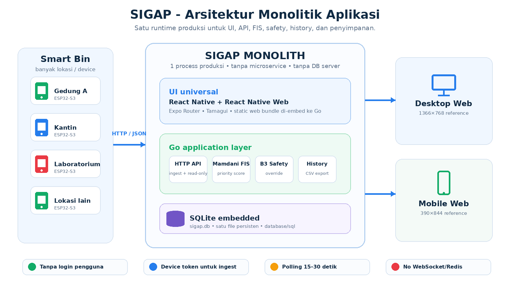
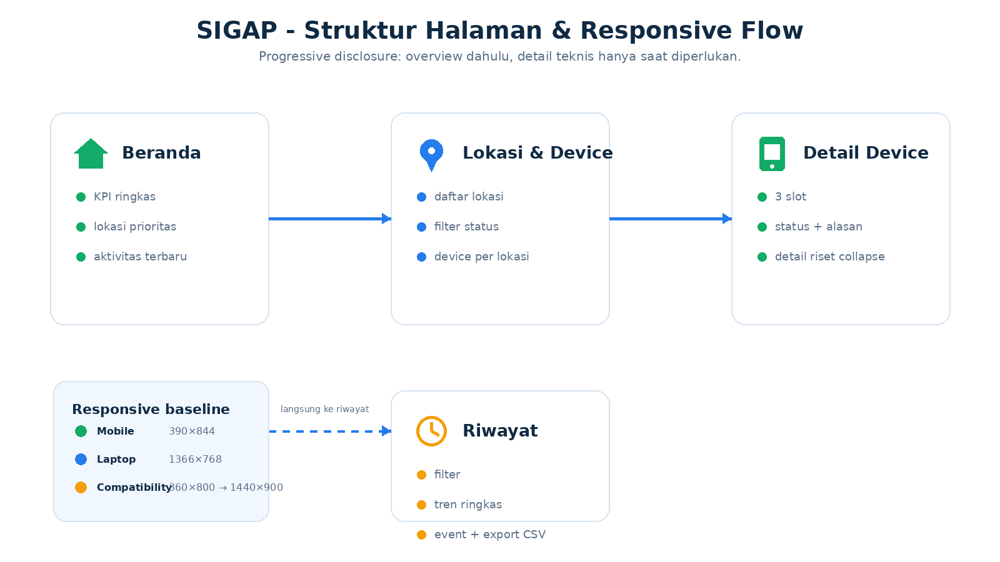

# SOFTWARE DESIGN DOCUMENT

## SIGAP Apps — SDD

Desain teknis monolitik untuk implementasi Research MVP dalam 5 hari.

<table>
<colgroup>
<col style="width: 33%" />
<col style="width: 33%" />
<col style="width: 33%" />
</colgroup>
<thead>
<tr class="header">
<th><strong>Version 
v1.0</strong></th>
<th><strong>Target 
Research-ready MVP</strong></th>
<th><strong>Delivery 
5 hari kerja</strong></th>
</tr>
</thead>
<tbody>
</tbody>
</table>

Dokumen ini sengaja ringkas. Fokusnya adalah keputusan yang langsung dibutuhkan untuk membangun dan menguji MVP dalam 5 hari, bukan proses delivery enterprise yang panjang.

# **1. Design Goals dan Constraint**

| **Desain teknis harus mengoptimalkan time-to-working-system. Production = satu Go process + satu file SQLite persisten; Expo/Node hanya dipakai pada build/development, bukan sebagai server kedua.** |
|-------------------------------------------------------------------------------------------------------------------------------------------------------------------------------------------------------|

| **Constraint** | **Keputusan desain**                                                               |
|----------------|------------------------------------------------------------------------------------|
| 5 hari         | Hindari abstraction layer dan dependency yang tidak langsung dipakai.              |
| Monolith       | Go melayani API, FIS/safety, history/export, serta static React Native Web bundle. |
| No login       | Monitoring public read-only; tidak ada session/user/role service.                  |
| Database       | SQLite embedded, bukan PostgreSQL/service database terpisah.                       |
| Realtime       | Polling 15–30 detik; tidak ada WebSocket/Redis/message broker.                     |
| Multi-device   | Data hierarchy: Location → Device → 3 Slot → Reading/Decision/Event.               |
| Research       | Raw/normalized reading dan FIS version disimpan agar keputusan dapat diaudit.      |

# **2. Arsitektur Monolitik**

Gambar 1. Arsitektur produksi SIGAP: satu runtime Go dan SQLite embedded.

| **Layer**        | **Teknologi**                          | **Tanggung jawab**                                                |
|------------------|----------------------------------------|-------------------------------------------------------------------|
| Universal UI     | React Native + React Native Web        | Komponen yang sama untuk mobile/web.                              |
| Tooling          | Expo + Expo Router                     | Build/export web dan routing universal.                           |
| Component system | Tamagui                                | Layout/styling universal, reuse komponen approved.                |
| Runtime          | Go net/http                            | Static hosting, API, validation, FIS, safety, event/history, CSV. |
| Persistence      | SQLite + database/sql + pure-Go driver | In-process storage tanpa DB server.                               |
| FIS              | Internal Go package                    | Mamdani inference + centroid + versioning.                        |
| Static web       | go:embed                               | Bundle hasil Expo dimasukkan ke binary Go.                        |

# **3. Repository dan Module Boundary**

Struktur dibuat cukup modular untuk diuji, tetapi tidak dipisah menjadi service.

| **Path**           | **Isi**                                                        |
|--------------------|----------------------------------------------------------------|
| cmd/sigap/         | main.go, startup config, router assembly.                      |
| internal/database/ | SQLite open/migrate/query helpers.                             |
| internal/ingest/   | Device authentication, payload validation, dedupe.             |
| internal/fuzzy/    | Membership, rule base, Mamdani inference, centroid, version.   |
| internal/safety/   | B3 Safety Override dan sensor-health rules.                    |
| internal/device/   | Online/offline, last_seen, aggregation per unit.               |
| internal/history/  | Event query, filter, CSV export.                               |
| internal/http/     | Handlers, response DTO, static file serving.                   |
| app/               | Expo Router screens.                                           |
| components/        | LocationCard, DeviceCard, SlotCard, StatusBadge, SensorMetric. |
| web-dist/          | Hasil export web; di-embed ke binary saat build.               |
| migrations/        | Schema SQLite minimal.                                         |

# **4. Data Flow dan Processing Sequence**

1\. ESP32 membaca sensor, melakukan basic filtering dan mengirim heartbeat/health.

2\. Device melakukan POST /api/ingest dengan credential perangkat.

3\. Go memvalidasi credential, schema, timestamp, sensor-health, dan duplikasi.

4\. Raw data disimpan; nilai operasional dinormalisasi sesuai konfigurasi penelitian.

5\. Jika input invalid, FIS dibypass dan decision = Data Invalid.

6\. Jika valid, Mamdani FIS menghasilkan score/status/reason.

7\. B3 Safety Override dievaluasi terpisah dan dapat mengalahkan status FIS.

8\. Reading, decision, dan event disimpan dalam transaksi yang sama/berurutan aman.

9\. UI mengambil overview/detail/history melalui GET endpoint dan polling 15–30 detik.

| **Precedence status agregat: Safety Alert \> Angkat \> Waspada \> Data Invalid/Offline \> Normal. Data Invalid dan Offline tetap dibedakan pada detail.** |
|-----------------------------------------------------------------------------------------------------------------------------------------------------------|

# **5. Data Model Minimum**

| **Entitas** | **Field minimum**                                                                                  |
|-------------|----------------------------------------------------------------------------------------------------|
| locations   | id, name, description/address_text, active                                                         |
| devices     | id, location_id, device_code, placement_label, online_state, last_seen, firmware_version           |
| slots       | id, device_id, waste_stream, operational_capacity                                                  |
| readings    | id, slot_id, recorded_at, raw_payload, fill, weight, ogi, accumulation, temperature, sensor_health |
| decisions   | reading_id, fis_score, fis_status, fis_version, dominant_reason, safety_state                      |
| events      | id, device_id, slot_id, event_type, severity, started_at, ended_at, metadata                       |

## 5.1 Index minimum

- devices(location_id), devices(device_code UNIQUE), devices(last_seen)

- slots(device_id, waste_stream UNIQUE per device)

- readings(slot_id, recorded_at DESC)

- events(started_at DESC), events(device_id, started_at DESC), events(severity, started_at DESC)

Retention dan compaction belum di-hardcode; tetap OPEN sampai ukuran dataset pilot diketahui.

# **6. API Contract MVP**

| **Endpoint**                  | **Access**                               | **Return/Fungsi**                           |
|-------------------------------|------------------------------------------|---------------------------------------------|
| POST /api/ingest              | Device credential                        | Reading + health + heartbeat.               |
| GET /api/overview             | Public read-only                         | KPI + lokasi prioritas + aktivitas terbaru. |
| GET /api/locations            | Public read-only                         | Daftar/search/filter lokasi.                |
| GET /api/locations/:id        | Public read-only                         | Device pada lokasi + status agregat.        |
| GET /api/devices/:id          | Public read-only                         | 3 slot + detail operasional.                |
| GET /api/devices/:id/research | Public read-only, bisa dipersempit nanti | Raw/normalized + FIS trace/version.         |
| GET /api/history              | Public read-only                         | Filtered event/readings.                    |
| GET /api/export.csv           | Public read-only                         | CSV sesuai filter.                          |

## 6.1 Ingestion payload — kontrak sederhana

<table>
<colgroup>
<col style="width: 100%" />
</colgroup>
<thead>
<tr class="header">
<th>POST /api/ingest 
Authorization: Bearer &lt;device-token&gt; 
Content-Type: application/json 
 
{ 
"device_id": "SIGAP-01", 
"recorded_at": "2026-09-16T18:00:00+07:00", 
"slots": [ 
{"stream":"organic","fill":72,"weight":12.5,"gas_raw":1234,"temperature":29.1}, 
{"stream":"inorganic","fill":45,"weight":8.2}, 
{"stream":"b3","fill":18,"weight":3.1,"temperature":32.0} 
], 
"health": {"wifi_rssi":-61,"uptime_s":91234} 
}</th>
</tr>
</thead>
<tbody>
</tbody>
</table>

Catatan: nama field sensor kandidat dapat berkembang, tetapi kontrak MVP menjaga device_id, recorded_at, slots, dan health stabil. Gas raw tidak ditampilkan sebagai “ppm bau”.

# **7. FIS, Safety, Offline, dan Invalid Data**

| **Module**     | **Behavior**                                                                                                                                 |
|----------------|----------------------------------------------------------------------------------------------------------------------------------------------|
| Validation     | Range/schema/timestamp/sensor-health check sebelum FIS.                                                                                      |
| Normalization  | Mengubah raw input menjadi Fill %, Weight Utilization %, OGI, Accumulation Time.                                                             |
| Mamdani FIS    | Fuzzification → rule evaluation → aggregation → centroid; fis_version wajib disimpan.                                                        |
| B3 Safety      | Layer terpisah; Safety Alert tidak menunggu/diturunkan oleh FIS priority.                                                                    |
| Data Invalid   | FIS dibypass; invalid reason disimpan dan ditampilkan.                                                                                       |
| Offline        | Derived dari last_seen menggunakan konfigurasi OFFLINE_AFTER_SECONDS; nilainya tidak di-hardcode di dokumen.                                 |
| Verified empty | Event kosong mengikuti logika hardware/FIS source of truth; aplikasi hanya memproses event/reset accumulation setelah kondisi terverifikasi. |

# **8. Frontend Design dan Responsive Behavior**

Gambar 2. Navigation + responsive targets.

| **Viewport** | **Layout**                                     |
|--------------|------------------------------------------------|
| 360×800      | 1 kolom; list/card; tanpa tabel lebar.         |
| 390×844      | REFERENCE MOBILE; bottom navigation ringkas.   |
| 768×1024     | 2 kolom.                                       |
| 1024×768     | 2–3 kolom.                                     |
| 1366×768     | REFERENCE DESKTOP; KPI + location/device grid. |
| 1440×900     | max-width ±1280 px; whitespace terkontrol.     |

| **Komponen reusable** | **Tanggung jawab**                                                      |
|-----------------------|-------------------------------------------------------------------------|
| LocationCard          | Nama lokasi, jumlah device, aggregate severity.                         |
| DeviceCard            | Device code, placement, online state, 3 fill summary.                   |
| SlotCard              | Waste stream, fill, status, secondary metrics.                          |
| StatusBadge           | Normal/Waspada/Angkat/Safety/Offline/Data Invalid; label selalu tampak. |
| ResearchPanel         | Collapse raw/normalized input, FIS version/score/reason.                |
| HistoryList/Table     | Mobile list vs desktop table dengan filter sama.                        |

# **9. Loading, Error, dan Performance Rules**

| **State/Rule** | **Implementasi**                                                   |
|----------------|--------------------------------------------------------------------|
| Loading        | Skeleton; jangan render 0 sebagai data final.                      |
| Empty          | Pesan spesifik: belum ada lokasi/device/event.                     |
| Offline        | Last seen + badge Offline; data lama diberi stale state.           |
| Data Invalid   | Invalid reason; jangan fallback ke Normal.                         |
| API error      | Pertahankan last valid data bila ada + retry.                      |
| Home           | Tidak import chart library; hanya KPI/card/optimized illustration. |
| Polling        | 15–30 detik; throttle/pause saat tab background bila memungkinkan. |
| History        | Server-side filter/pagination bila dataset tumbuh.                 |
| Images         | Optimized PNG/WebP dan lazy-load asset di bawah fold.              |

# **10. Security Boundary**

| **Surface**      | **Rule**                                                                         |
|------------------|----------------------------------------------------------------------------------|
| Monitoring UI    | Read-only tanpa login/session/role.                                              |
| Device ingestion | Credential wajib; token tidak pernah dikirim balik ke browser.                   |
| Write/config     | Tidak ada dari public UI MVP.                                                    |
| Secrets          | Wi-Fi, token, calibration secret tidak pernah masuk response/export.             |
| Research export  | Hanya data penelitian yang diperlukan.                                           |
| CORS             | Jika UI dan API satu origin, gunakan same-origin; tidak perlu membuka CORS luas. |

# **11. Build, Deployment, dan Runtime**

1\. Build React Native Web/Expo menjadi static web bundle.

2\. Salin hasil export ke web-dist/.

3\. Compile Go dengan go:embed untuk menyertakan web-dist dan migration.

4\. Deploy satu binary SIGAP + satu persistent sigap.db.

5\. Jalankan binary; startup membuka DB, menjalankan migration idempotent, lalu HTTP server.

| **Production tidak menjalankan Node server, PostgreSQL, Redis, queue, auth service, atau microservice.** |
|----------------------------------------------------------------------------------------------------------|

# **12. Testing Strategy — Sengaja Ringkas**

| **Level**  | **Yang diuji**                                                                    | **Kapan**                    |
|------------|-----------------------------------------------------------------------------------|------------------------------|
| Unit       | Fuzzy membership/rules/centroid, safety override, validation, status aggregation. | Hari 2–5 saat module dibuat. |
| API        | Ingest valid/invalid/token salah; overview/location/device/history/export.        | Hari 1–5.                    |
| UI smoke   | Beranda → Lokasi → Device → Riwayat; loading/error/offline/invalid.               | Hari 3–5.                    |
| Responsive | 6 viewport target.                                                                | Hari 3–5; final Hari 5.      |
| E2E        | Simulator/hardware → ingest → DB → FIS → UI → CSV.                                | Hari 5.                      |

**Tidak perlu membuat QA cycle berlapis atau environment matrix besar. Untuk MVP 5 hari, satu automated unit/API suite + smoke responsive + satu end-to-end path sudah menjadi gate rilis.**

# **13. Implementation Plan 5 Hari**

| **Hari** | **Code target**                                                   | **Gate**                                        |
|----------|-------------------------------------------------------------------|-------------------------------------------------|
| 1        | Go bootstrap, SQLite migration, static shell, ingestion handler.  | POST /api/ingest → row tersimpan.               |
| 2        | Validation, normalization, fuzzy, safety, aggregation, read APIs. | Simulator menghasilkan status + version/reason. |
| 3        | Expo/Tamagui Beranda, Lokasi, Device cards, polling.              | 390×844 + 1366×768 usable.                      |
| 4        | Detail Device, ResearchPanel, History, CSV, states.               | Semua P0 page functional.                       |
| 5        | Integration, responsive matrix, restart/offline/invalid, bugfix.  | UAT table pass; one deployable binary.          |

# **14. Risiko dan Cut-Line**

| **Risiko**                  | **Mitigasi cepat**                                                                               |
|-----------------------------|--------------------------------------------------------------------------------------------------|
| Hardware belum stabil       | Gunakan simulator payload yang sama dengan kontrak ingest; hardware swap tidak mengubah UI/API.  |
| Threshold/FIS masih berubah | Version rule/membership; jangan hardcode ke UI.                                                  |
| Expo web issue              | Pertahankan UI sederhana dan dependency minimal; web target lebih penting daripada native build. |
| Dataset history cepat besar | Index dari awal; pagination/filter server-side bila perlu.                                       |
| Waktu habis                 | Potong P1 chart/polish, bukan P0 data path/status/history/CSV/responsive.                        |
