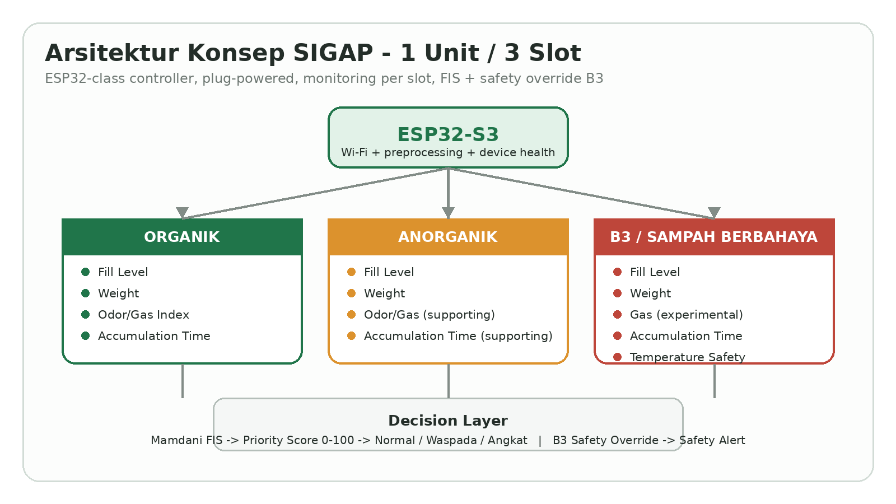
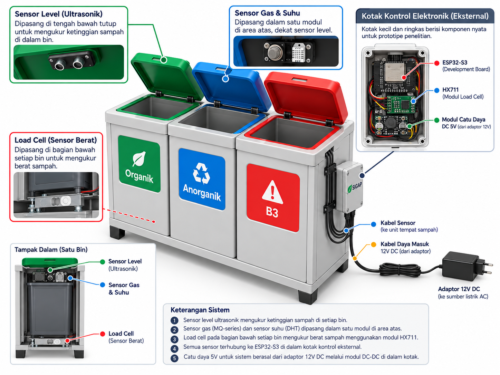
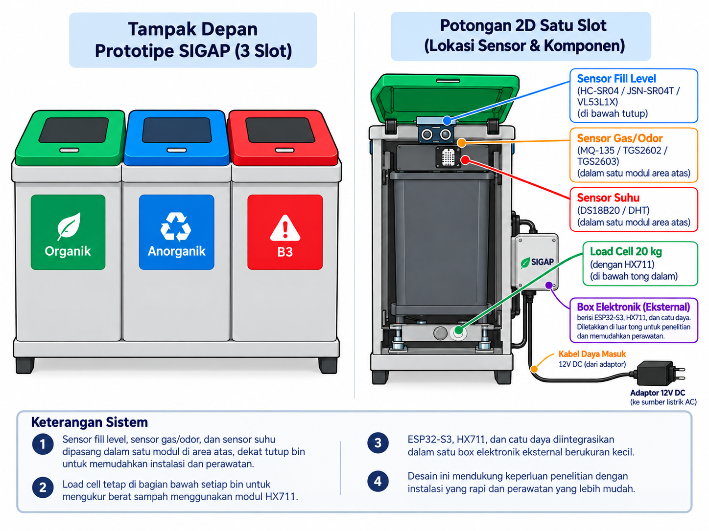
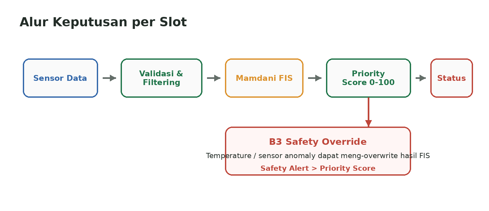
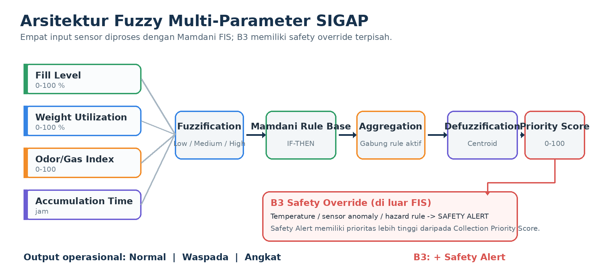

**SIGAP SMART BIN**

**Dokumen Konsep Sistem, Detail Alat, Rencana Eksperimen Sensor, dan
Estimasi RAB**

IoT + Fuzzy Multi-Parameter \| Organik - Anorganik - B3\
Studi Kasus: Kampus UPI di Cibiru

<table>
<colgroup>
<col style="width: 100%" />
</colgroup>
<thead>
<tr>
<th>STATUS DOKUMEN 
Source of Truth v0.8 - baseline desain penelitian dan pengadaan. Sensor
fill/gas final, membership FIS, dan threshold safety B3 tetap
PROVISIONAL/OPEN sampai eksperimen selesai. Load cell 20 kg + HX711
dikunci sebagai baseline per slot. Sensor fill level, gas/odor, dan
suhu/RH dikelompokkan pada modul area atas setiap slot; load cell tetap
di bawah; ESP32-S3, HX711, ADC opsional, dan regulasi daya berada pada
box elektronik eksternal yang ringkas. Basis FIS v0.8 diperkuat dengan
kajian jurnal Scopus dan peta lokasi kutipan.</th>
</tr>
</thead>
<tbody>
</tbody>
</table>

**Tanggal: 16 September 2026\
Harga pada dokumen ini adalah estimasi RAB/market snapshot, bukan
quotation vendor final.**

# Daftar Isi

> 1\. Ringkasan Eksekutif
>
> 2\. Ruang Lingkup dan Keputusan yang Dikunci
>
> 3\. Konsep Produk dan Tiga Waste Stream
>
> 4\. Fitur Sistem
>
> 5\. Arsitektur Teknis

5.1 Ilustrasi Prototipe dan Tata Letak Sensor

> 6\. Definisi Parameter dan Sensor
>
> 7\. Logika Fuzzy Multi-Parameter, Basis Literatur, dan B3 Safety
> Override
>
> 8\. Rencana Eksperimen Sensor
>
> 9\. Detail Alat dan Komponen

9.1 Peran ToF dan Figaro pada Eksperimen

> 10\. RAB Modular Berdasarkan Pilihan Sensor
>
> 11\. Strategi Pengadaan
>
> 12\. Acceptance Criteria
>
> 13\. Open Decisions
>
> 14\. Referensi Literatur dan Sumber Harga

# 1. Ringkasan Eksekutif

SIGAP adalah sistem tempat sampah cerdas tiga-slot berbasis IoT yang
memonitor kondisi aktual setiap slot secara independen dan mengubah data
sensor menjadi prioritas pengangkutan melalui Fuzzy Inference System
(FIS). Kategori slot yang dikunci untuk baseline penelitian adalah
Organik, Anorganik, dan B3/Sampah Berbahaya. Satu unit tiga-slot
menggunakan satu ESP32-S3 sebagai controller utama. Sistem menggunakan
aplikasi web online tanpa login untuk pengguna umum, tanpa peta/GPS, dan
perangkat memperoleh daya langsung dari listrik sehingga tidak memiliki
workflow charging. Pada v0.8, desain FIS dipertegas berdasarkan preseden
jurnal Scopus: multi-input fuzzy untuk fill+gas, Mamdani FIS untuk
intelligent waste management, serta studi multi-parameter
height/mass/gas/timestamp untuk priority analytics.

Perubahan utama setelah B3 dimasukkan adalah penambahan safety layer.
Slot B3 tidak boleh dinilai hanya berdasarkan penuh/tidak penuh. FIS
menghasilkan priority score, tetapi kondisi keselamatan seperti
temperatur abnormal atau sensor anomaly dapat meng-overwrite hasil FIS
menjadi SAFETY ALERT. Sensor B3, khususnya kanal gas dan threshold
keselamatan, wajib diuji dan tidak dikunci sebelum eksperimen.

<table>
<colgroup>
<col style="width: 100%" />
</colgroup>
<thead>
<tr>
<th><strong>PRINSIP PENELITIAN 
</strong>Sensor dipilih berdasarkan data eksperimen, bukan popularitas
komponen. Harga murah dan ketersediaan pasar tetap menjadi kriteria,
tetapi pemilihan final harus mempertimbangkan akurasi, repeatability,
robustness, maintenance, dan integrasi dengan ESP32.</th>
</tr>
</thead>
<tbody>
</tbody>
</table>

# 2. Ruang Lingkup dan Keputusan yang Dikunci

| **Item** | **Status** | **Keputusan** |
|----|----|----|
| Kategori 3 slot | LOCKED | Organik \| Anorganik \| B3 / Sampah Berbahaya |
| Jumlah produk fisik | LOCKED | 2 unit prototipe; masing-masing 3 slot |
| Controller | LOCKED | ESP32-S3-class, 1 controller per unit tiga-slot; current experimental RAB membeli 1 unit controller. |
| Power | LOCKED | Direct plug melalui regulated AC/DC power supply; tanpa charging |
| Dashboard | LOCKED | Web online, read-only tanpa login untuk monitoring; device/API tetap authenticated |
| Lokasi | LOCKED | List/filter lokasi; tidak menggunakan map/GPS |
| Decision engine | LOCKED | Mamdani FIS sebagai baseline |
| B3 safety override | LOCKED | Safety Alert dapat meng-overwrite hasil FIS |
| Fill sensor final | PROVISIONAL | HC-SR04 vs JSN-SR04T vs VL53L1X diuji |
| Load cell | LOCKED | 20 kg single-point per slot + HX711. Validasi mekanik tetap dilakukan untuk memastikan margin beban dan repeatability. |
| Gas sensor B3 | OPEN | Eksperimental; dapat dieliminasi bila tidak memberi informasi stabil |
| Threshold FIS/safety | OPEN | Harus diturunkan dari literature prior + eksperimen SIGAP |

# 3. Konsep Produk dan Tiga Waste Stream

Setiap unit memiliki tiga slot fisik. Masing-masing slot memiliki ID,
data sensor, status, timestamp, dan decision profile sendiri. Bodi
Produk A dan Produk B dapat berbeda sesuai kebutuhan implementasi,
tetapi logic elektronik dan data model sebaiknya sama agar hasil
penelitian dapat dibandingkan.

| **Slot** | **Contoh aliran** | **Parameter** | **Status utama** | **Catatan** |
|----|----|----|----|----|
| Organik | Sisa makanan / mudah terurai | Fill, Weight, OGI, Time | Normal / Waspada / Angkat | Gas/odor dan time relevan kuat. |
| Anorganik | Sampah kering/anorganik sesuai kebijakan kampus | Fill, Weight dominan; OGI/Time supporting | Normal / Waspada / Angkat | Tidak memaksa time tinggi sebagai alasan angkut tunggal. |
| B3 / Sampah Berbahaya | Sampah yang memerlukan penanganan khusus | Fill, Weight, Time, gas experimental + Temperature safety | Aman / Pantau / Prioritas Pengambilan / Safety Alert | Safety Alert tidak menunggu slot penuh. |

# 4. Fitur Sistem

| **Fitur** | **Definisi** |
|----|----|
| Monitoring 3 slot independen | Setiap slot menampilkan kondisi dan status sendiri. |
| Monitoring berdasarkan lokasi | Lokasi ditampilkan sebagai daftar/filter, bukan peta. |
| Fill Level (%) | Dihitung dari jarak empty-full yang dikalibrasi. |
| Weight Utilization (%) | Berat kg tetap ditampilkan di UI, tetapi FIS menggunakan % kapasitas operasional. |
| Odor/Gas Index (OGI) | Indeks terkalibrasi; bukan “ppm bau”. |
| Accumulation Time | Durasi sejak verified-empty event terakhir. |
| B3 Temperature Safety | Kanal keselamatan terpisah untuk mendeteksi kondisi termal abnormal. |
| Mamdani FIS | Menghasilkan Collection Priority Score 0-100. |
| Safety Override | Untuk B3, safety state mengalahkan priority score. |
| Sensor Health | ONLINE / DEGRADED / FAILED / DATA INVALID. |
| Device Health | Status ESP32, Wi-Fi, API, last-seen. |
| Event Log | Last collection, verified-empty, B3 warning, sensor failure. |
| No-login monitoring | Halaman monitoring publik/read-only; konfigurasi dan ingestion tetap protected. |

# 5. Arsitektur Teknis

Satu ESP32-S3 cukup untuk satu unit tiga-slot. Untuk memudahkan
penelitian dan perawatan, sensor non-berat pada tiap slot dikelompokkan
di area atas/dekat tutup: sensor fill level berada di tengah mengarah ke
permukaan sampah, sedangkan sensor gas/odor dan sensor suhu/RH
ditempatkan berdekatan pada modul yang sama tanpa menutupi bidang
pandang sensor fill. Load cell 20 kg tetap berada di bawah wadah
internal. ESP32-S3, tiga HX711, ADC eksternal bila memakai Figaro, serta
modul regulasi daya ditempatkan pada box elektronik eksternal berukuran
ringkas. FIS dapat dijalankan pada edge atau backend; untuk penelitian
awal, preprocessing dan sensor-health dilakukan di ESP32, sedangkan
penyimpanan data, evaluasi model, dan dashboard berada di backend.

## 5.1 Ilustrasi Prototipe dan Tata Letak Sensor

<figure>

<figcaption>
Gambar 1. Tampak 3D prototipe tiga-slot dengan sensor
area atas, load cell bawah, dan box elektronik
eksternal.
</figcaption>
</figure>

<figure>

<figcaption>
Gambar 2. Potongan 2D satu slot dan penempatan komponen
penelitian.
</figcaption>
</figure>

# 6. Definisi Parameter dan Sensor

| **Parameter** | **Unit** | **Sensor/Sumber** | **Slot** | **Peran** | **Status** |
|----|----|----|----|----|----|
| Fill Level | 0-100% | HC-SR04 / JSN-SR04T / VL53L1X | Semua slot | FIS input | Final sensor dipilih setelah benchmark. |
| Weight | kg; FIS menggunakan Weight Utilization % | Load cell 20 kg + HX711 | Semua slot | FIS input | 20 kg dikunci sebagai baseline per slot; validasi calibration/corner loading tetap wajib. |
| Odor/Gas Index | 0-100 / Low-Med-High | MQ-135/136/137/138; TGS2602/2603; SGP40; MQ-4 low-priority; ZE03-H2S/NH3 optional reference | Utama Organik; supporting Anorganik; experimental B3 | FIS input / supporting | Final sensor/array ditentukan lewat benchmark; jangan mengklaim “ppm bau”. |
| Accumulation Time | jam/hari | Timestamp backend/NTP; DS3231 fallback | Semua slot | FIS input | Reset hanya setelah verified-empty. |
| Temperature/RH | degC, %RH | SHT31/SHT4x | Organik dan B3 | Kompensasi/metadata | Bukan FIS input universal v1. |
| B3 Temperature Safety | degC | DS18B20 candidate | B3 | Safety layer | Threshold final hasil eksperimen. |
| Sensor Health | state | Self-check/software | Semua slot | Bypass FIS saat invalid | DATA INVALID tidak boleh dianggap Normal. |

Fill(%) = 100 x (D_empty - D_measured) / (D_empty - D_full)\
\
WeightUtilization(%) = 100 x M_net / M_operational,max\
\
AccumulationTime = t_now - t_last_verified_empty

# 7. Logika Fuzzy Multi-Parameter, Basis Literatur, dan B3 Safety Override

Output FIS adalah Collection Priority Score 0-100 yang dipetakan ke
Normal, Waspada, atau Angkat. Membership function awal boleh menggunakan
literature prior, tetapi angka final tidak dianggap ilmiah sampai
tervalidasi pada data SIGAP. Pada slot B3, safety rules berjalan
paralel. Contoh: priority score rendah tidak dapat membatalkan
temperature safety trigger.

| **Profile** | **Input** | **Prinsip rule** |
|----|----|----|
| Organik | Fill, Weight, OGI, Time | OGI dan time dapat menaikkan prioritas meski fill belum tinggi. |
| Anorganik | Fill, Weight, OGI/Time supporting | Fill/weight dominan; time tinggi saja tidak otomatis Angkat. |
| B3 | Fill, Weight, Time, gas experimental | Safety state terpisah. Temperature/sensor anomaly dapat memicu Safety Alert. |

## 7.1 Basis Jurnal Scopus dan Peta Kutipan

Penelusuran literatur memperlihatkan bahwa fuzzy logic sudah digunakan
pada smart-waste, termasuk sebagai sensor-fusion engine dan decision
engine. Namun, dalam penelusuran ini belum ditemukan artikel Scopus yang
menggabungkan empat input SIGAP secara sekaligus - Fill Level, Weight,
Odor/Gas, dan Accumulation Time - ke dalam satu FIS untuk menghasilkan
collection priority. Karena itu, novelty SIGAP harus diposisikan sebagai
integrasi dan evaluasi empat domain informasi tersebut, bukan klaim
bahwa fuzzy atau IoT pada waste management belum pernah digunakan.

| **Paper / venue** | **Status Scopus** | **Parameter & metode** | **Letak bukti yang perlu dibuka** | **Implikasi untuk SIGAP** |
|----|----|----|----|----|
| Sung et al. (2022) - Smart Garbage Bin Based on AIoT, Intelligent Automation & Soft Computing 32(3), 1387-1401. DOI 10.32604/iasc.2022.022828 | Ya - journal page/ISSN metadata mencantumkan Scopus | Waste percentage + methane level -\> MISO fuzzy -\> ON/OFF notification. | PDF p.1394 Table 1 (Bin conditions); p.1395 Section 4.1 Fuzzy Method; Fig.10-11. | Preseden langsung bahwa fill level dan gas dapat menjadi multi-input FIS pada smart bin. |
| Thaseen Ikram et al. (2023) - An Intelligent Waste Management Application Using IoT and a Genetic Algorithm-Fuzzy Inference System, Applied Sciences 13(6), 3943. DOI 10.3390/app13063943 | Ya - Applied Sciences journal page mencantumkan Scopus | Hybrid GA-FIS; Mamdani inference; IoT sensor data; rule optimization; centroid defuzzification. | Abstract; Section 3.1 Internal Components; Section 3.2 Methodology of GA-FIS; Equation (1); Table 3; defuzzification subsection. | Landasan implementasi Mamdani FIS, IF-THEN rules, membership functions, aggregation, dan centroid. |
| Mishra et al. (2022) - Prioritized and predictive intelligence of things enabled waste management model in smart and sustainable environment, PLOS ONE 17(8), e0272383. DOI 10.1371/journal.pone.0272383 | Ya - PLOS journal information mencantumkan Scopus | Bin height + bin mass + poisonous gas + timestamp -\> priority/prediction; decision engine memakai Random Forest, bukan FIS. | Abstract; Section 3.1 Dataset used; Table 4 poisonous gas threshold; Table 5 sensor dataset; Section 3.2 proposed model. | Sangat dekat dengan empat domain input SIGAP; memperkuat pemilihan parameter meskipun decision engine berbeda. |
| Abuga & Raghava (2021) - Real-time smart garbage bin mechanism for solid waste management in smart cities, Sustainable Cities and Society 75, 103347. DOI 10.1016/j.scs.2021.103347 | Scopus-indexed journal metadata | Real-time smart-bin monitoring + fuzzy expert system for decision/deployment. | Abstract dan Introduction/contribution statement pada ScienceDirect. | Menguatkan bahwa fuzzy expert system relevan untuk real-time decision-making pada waste management. |

## 7.2 Kutipan Kunci dan Lokasi Aslinya

*Kutipan berikut sengaja dibuat singkat agar mudah dicocokkan langsung
ke paper asli. Teks di luar tanda kutip adalah sintesis SIGAP, bukan
kutipan penulis.*

| **Sumber** | **Kutipan singkat** | **Lokasi** | **Apa yang dibuktikan** |
|----|----|----|----|
| Sung et al. (2022) | “Two parameters were used as input: the percentage of waste and methane level.” | PDF p.1395, Section 4.1 Fuzzy Method. Table input categories ada di p.1394 Table 1. | Fuzzy multi-input untuk fill + gas memang sudah diimplementasikan pada smart bin. |
| Thaseen Ikram et al. (2023) | “A Mamdani model is used to estimate waste management.” / “The centroid method is utilized for defuzzification.” | Abstract dan Section 3.2 GA-FIS / bagian Defuzzification. | Mamdani + centroid memiliki preseden langsung pada intelligent waste management. |
| Mishra et al. (2022) | “The waste collected in smart bins are parameterized with two variables, which include bin’s height and bin’s mass.” | Section 3.1 Dataset used. Gas ada di Table 4-5; timestamp/prioritization dijelaskan di Abstract dan Section 3.2. | Height/fill, mass/weight, gas, dan waktu telah dipakai bersama untuk waste-priority analytics. |
| Abuga & Raghava (2021) | “Fuzzy logic is applied in the strategic deployment of smart garbage bins across the smart cities.” | Abstract, ScienceDirect article page. | Fuzzy dipakai untuk real-time waste-management decision support. |

**Tautan verifikasi:** [<u>Sung
PDF</u>](https://cdn.techscience.cn/ueditor/files/iasc/TSP_IASC-32-3/TSP_IASC_22828/TSP_IASC_22828.pdf)
\| [<u>Applied Sciences</u>](https://www.mdpi.com/2076-3417/13/6/3943)
\| [<u>PLOS
ONE</u>](https://journals.plos.org/plosone/article?id=10.1371/journal.pone.0272383)
\| [<u>Sustainable Cities and
Society</u>](https://www.sciencedirect.com/science/article/pii/S2210670721006223)

## 7.3 Sintesis Desain FIS SIGAP

Baseline SIGAP menggunakan Mamdani FIS karena mudah dijelaskan melalui
linguistic membership dan rule IF-THEN, memiliki preseden pada Applied
Sciences (2023), dan sesuai dengan arah proposal. Empat input
operasional tetap: Fill Level (%), Weight Utilization (%), Odor/Gas
Index (0-100), dan Accumulation Time (jam). Output tunggal adalah
Collection Priority Score 0-100.

<figure>

<figcaption>
Gambar 3. Arsitektur Fuzzy multi-parameter SIGAP: empat
input -&gt; Mamdani FIS -&gt; priority score, dengan B3 Safety Override
di luar FIS.
</figcaption>
</figure>

| **Elemen FIS** | **Baseline v0.8** | **Status ilmiah** |
|----|----|----|
| Input 1 - Fill Level | 0-100%; Low / Medium / High | Literature-supported sebagai variabel utama; anchor final divalidasi eksperimen. |
| Input 2 - Weight Utilization | 0-100% kapasitas operasional; Low / Medium / High | Literatur mendukung weight sebagai complementary physical condition; membership final eksperimen. |
| Input 3 - Odor/Gas Index | 0-100; Low / Medium / High | Dibangun dari sensor gas terpilih; tidak menggunakan label universal “ppm bau”. |
| Input 4 - Accumulation Time | jam; Short / Medium / Long | Software-derived dari verified-empty timestamp; profile dapat berbeda antar waste stream. |
| Inference | Mamdani min/max sebagai baseline | PROVISIONAL sampai diuji terhadap data SIGAP. |
| Membership shape | Triangular / trapezoidal | Preseden umum pada FIS dan mudah dituning. |
| Defuzzification | Centroid | Didukung implementasi Thaseen Ikram et al. (2023). |
| Output | Collection Priority Score 0-100 -\> Normal / Waspada / Angkat | Threshold output final hasil validasi, bukan angka dashboard. |
| B3 safety | Independent override | Temperature/sensor anomaly/hazard rule dapat memicu Safety Alert tanpa menunggu score FIS. |

## 7.4 Rule Space dan Rule Base Awal

Dengan empat input dan tiga linguistic membership per input, ruang
kombinasi maksimum adalah 3^4 = 81 kombinasi. SIGAP tidak harus menulis
81 rule secara naif. Rule base dapat dibuat terstruktur berdasarkan
domain knowledge, lalu dipangkas/tuning memakai pilot data dan expert
labels. Semua rule berikut adalah starting hypotheses untuk eksperimen,
bukan hasil final.

| **Contoh kondisi** | **Output awal** | **Rasional** |
|----|----|----|
| Fill High AND Weight High | Angkat | Dua indikator fisik menunjukkan kapasitas operasional sudah tinggi. |
| Fill High AND (OGI Medium OR High) | Angkat | Penuh + indikasi odor/decomposition menaikkan urgensi. |
| OGI High AND Time Long | Angkat / prioritas tinggi | Sampah dapat perlu ditangani walau fill belum maksimum. |
| Fill Medium AND Weight Medium AND OGI Low AND Time Short | Waspada | Kapasitas meningkat tetapi belum ada indikator urgensi kuat. |
| Fill Low AND Weight Low AND OGI Low AND Time Short | Normal | Semua indikator masih rendah. |
| B3 Temperature abnormal OR sensor hazard flag | Safety Alert (override) | Bypass FIS; safety tidak boleh bergantung pada priority score. |

## 7.5 Profil FIS per Waste Stream

| **Waste stream** | **Input utama** | **Input pendukung** | **Catatan rule** |
|----|----|----|----|
| Organik | Fill, Weight, OGI, Time | Temperature/RH sebagai kompensasi gas | OGI dan Time dapat menaikkan prioritas sebelum bin penuh. |
| Anorganik | Fill, Weight | OGI dan Time | Fill/weight lebih dominan; time tinggi saja tidak otomatis Angkat. |
| B3 / Sampah Berbahaya | Fill, Weight, Time; gas experimental | Temperature + sensor-health sebagai safety layer | FIS menentukan collection priority; safety override berdiri terpisah dan memiliki prioritas lebih tinggi. |

## 7.6 Posisi Novelty yang Lebih Defensible

Klaim yang harus dihindari: “fuzzy belum pernah digunakan untuk smart
waste” atau “fill + gas belum pernah masuk FIS”. Literatur di atas
membuktikan kedua klaim tersebut tidak benar. Posisi novelty yang lebih
defensible adalah: pengembangan dan evaluasi FIS multi-parameter yang
mengintegrasikan kondisi fisik (fill level dan weight), indikator
lingkungan/dekomposisi (odor/gas), dan informasi temporal (accumulation
time) untuk menghasilkan collection priority secara adaptif pada tiga
waste stream, dengan B3 safety override yang terpisah dari keputusan
operasional.

*Catatan evidence: pernyataan “belum ditemukan empat input tersebut
sekaligus dalam satu FIS” harus ditulis sebagai hasil penelusuran
literatur penelitian ini, bukan sebagai klaim absolut bahwa paper
semacam itu tidak ada di seluruh basis data.*

# 8. Rencana Eksperimen Sensor

## 8.1 Fill Level

Bandingkan HC-SR04, JSN-SR04T, dan VL53L1X pada 0-100% fill. Uji
setidaknya tiga kondisi material: light/irregular, dense mixed, dan
wet/organic-like. Ukur MAE, RMSE, P95 error, false-full, false-not-full,
dropout, dan sensitivity terhadap surface geometry.

## 8.2 Weight

Gunakan load cell 20 kg + HX711 sebagai baseline yang telah dikunci.
Validasi pada 0/10/25/50/75/90/100% kapasitas kerja yang direncanakan.
Uji loading center dan corner, repeatability, hysteresis, zero drift,
dan creep. Tujuannya bukan lagi memilih rating 20 vs 50 kg, tetapi
membuktikan bahwa konfigurasi 20 kg memadai dan repeatable untuk slot
SIGAP.

## 8.3 Organic Gas/Odor

Benchmark gas/odor diperluas agar pemilihan sensor tidak hanya
bergantung pada MQ-135. Kandidat yang diuji dapat mencakup MQ-135 (broad
air-quality), MQ-136 (H2S), MQ-137 (NH3), MQ-138 (VOC/formaldehyde),
MQ-4 (CH4, low-priority untuk odor), TGS2602 (broad VOC/NH3/H2S),
TGS2603 (amine/sulfur/food odor), serta SGP40 (digital VOC Index). Rekam
suhu/RH selama pengujian. Output utama tetap normalized response /
Odor-Gas Index (OGI), bukan “ppm bau”. Sensor elektrokimia seperti
ZE03-H2S atau ZE03-NH3 dapat dipakai sebagai reference channel opsional
pada rig validasi, bukan sebagai sensor wajib pada setiap slot.

## 8.4 B3 Gas Channel

Uji hanya dengan safe surrogate/reference condition. Jangan membuat
kebocoran, uap berbahaya, atau thermal runaway. Pertanyaan eksperimen:
apakah kanal gas memberi informasi stabil dan repeatable? Jika tidak,
hapus dari FIS B3.

## 8.5 B3 Temperature

Bandingkan DS18B20 dengan reference thermometer pada rentang suhu aman
dan terkontrol. Ukur accuracy, repeatability, response time, dan
placement sensitivity. Threshold safety belum dikunci pada fase ini.

## 8.6 Verified Empty

Validasi reset timer menggunakan gabungan penurunan fill + weight dan
kestabilan near-empty selama beberapa window. Jangan menggunakan uptime
ESP32 sebagai waktu penumpukan.

# 9. Detail Alat dan Komponen

| **Komponen** | **Jenis** | **Fungsi** | **Catatan** |
|----|----|----|----|
| ESP32-S3 DevKitC-1 | MCU dual-core + Wi-Fi | Controller seluruh 3 slot dalam satu unit | Satu ESP32-S3 menangani ketiga slot dan berada di box elektronik eksternal yang ringkas. |
| HC-SR04 | Ultrasonic non-waterproof | Benchmark fill | Sangat murah; lebih cocok bench/indoor. |
| JSN-SR04T | Ultrasonic waterproof | Kandidat fill utama | Lebih sesuai lingkungan lembap, tetapi dead-zone/beam harus diuji. |
| VL53L1X | Optical Time-of-Flight | Pembanding teknologi fill level | ToF = Time-of-Flight optik. Dibeli 1 unit hanya untuk benchmark terhadap ultrasonic; bukan sensor tambahan wajib pada desain final. |
| Load Cell 20 kg | Strain gauge single-point | Weight | Baseline dikunci 20 kg per slot; lakukan kalibrasi dan corner-loading test. |
| HX711 | 24-bit load-cell ADC | Acquisition weight | Satu HX711 per load cell/slot; ketiganya ditempatkan di box elektronik eksternal. |
| MQ-135 | Broad MOS gas module | Comparator ekonomis | Tidak cukup selektif untuk klaim ppm bau. |
| TGS2602 | Broad VOC/NH3/H2S MOS | Kandidat kanal broad untuk Odor/Gas Index | Figaro TGS2602 digunakan sebagai pembanding MQ-135 untuk respons broad VOC/NH3/H2S. Output bukan ppm bau. |
| TGS2603 | Odor/amine/sulfur MOS | Kandidat kanal odor organik | Figaro TGS2603 lebih sensitif terhadap odor/amine/sulfur yang relevan pada pembusukan organik; dipasangkan dengan TGS2602 saat eksperimen OGI. |
| SHT31-D / SHT4x | Temperature + RH | Kompensasi gas | Ditempatkan pada modul sensor area atas bersama kanal gas/odor; gunakan sebagai kompensasi T/RH. |
| DS18B20 | Digital temperature probe | B3 safety candidate | Murah, digital 1-Wire, mudah diganti. |
| DS3231 | RTC | Fallback timestamp | Optional; NTP/backend tetap sumber utama waktu. |
| 12 V 5 A PSU + buck | Direct power | Power system | Regulasi daya/buck ditempatkan di box elektronik eksternal; hanya kabel input daya dari sumber listrik yang masuk ke box. Tidak ada baterai/charger. |
| ADS1115 | 16-bit external ADC, 4-channel I2C | Acquisition analog sensor gas Figaro | Opsional tetapi direkomendasikan bila memakai TGS2602/TGS2603 agar pembacaan analog lebih konsisten daripada mengandalkan ADC internal ESP32. Satu unit cukup untuk 3 kanal; dua unit untuk 6 kanal dual-Figaro. |
| MQ-4 | Methane MOS gas module | Kandidat CH4 / decomposition gas | Murah dan mudah didapat, tetapi methane tidak identik dengan odor. Low-priority untuk benchmark bau; cocok bila riset ingin memantau CH4. |
| MQ-136 | H2S-selective MOS gas sensor | Kandidat sulfur / rotten-egg odor | Lebih spesifik terhadap H2S dibanding MQ-135; relevan untuk pembusukan organik. Tetap memerlukan preheat, kalibrasi, dan kompensasi lingkungan. |
| MQ-137 | NH3-selective MOS gas sensor | Kandidat ammonia / amine-related decay | Lebih spesifik terhadap NH3 daripada MQ-135. Menarik untuk membandingkan indikator ammonia terhadap OGI dan waktu penumpukan. |
| MQ-138 | VOC/formaldehyde MOS gas sensor | Kandidat broad VOC | Mendeteksi HCHO/benzene/alcohol/acetone/VOC; berguna sebagai kanal VOC tambahan tetapi tetap cross-sensitive. |
| SGP40 | Digital MOX VOC sensor, I2C | VOC Index digital | Tidak membutuhkan ADC eksternal; menghasilkan VOC Index dan mendukung humidity compensation. Tidak mengidentifikasi molekul VOC secara spesifik. |
| ZE03-H2S / ZE03-NH3 | Electrochemical gas reference module | Reference channel gas spesifik | Opsional untuk rig validasi. Lebih kuantitatif untuk H2S/NH3 dibanding MOS, tetapi mahal dan tidak wajib dipasang pada setiap slot. |

## 9.1 Peran ToF dan Figaro pada Eksperimen

VL53L1X ToF tidak menambah parameter baru. Sensor ini hanya menjadi
pembanding optical ranging terhadap HC-SR04/JSN-SR04T untuk menentukan
teknologi fill-level yang paling stabil pada geometri sampah nyata.
Karena fungsinya benchmark, cukup 1 unit pada RAB eksperimen.

Opsi sensor gas/odor pada v0.8 dibagi menjadi tiga kelompok. (1)
MQ-series ekonomis: MQ-135 untuk broad air-quality, MQ-136 untuk H2S,
MQ-137 untuk NH3, MQ-138 untuk VOC/formaldehyde, dan MQ-4 untuk CH4;
MQ-4 tidak diprioritaskan sebagai sensor “bau” karena methane bukan
indikator odor langsung. (2) Sensor odor/VOC yang lebih
research-oriented: TGS2602, TGS2603, dan SGP40 digital VOC Index. (3)
Reference electrochemical opsional: ZE03-H2S/ZE03-NH3 untuk validasi
konsentrasi gas spesifik. Semua kandidat dibandingkan berdasarkan
repeatability, drift, separation antar kondisi pembusukan, sensitivitas
T/RH, biaya, dan kemudahan integrasi. Sensor final dipilih setelah
eksperimen.

# 10. RAB Modular Berdasarkan Pilihan Sensor

RAB pada versi ini dibuat modular agar tim dapat memilih paket
berdasarkan sensor yang dipakai. Tidak ada RAB Fase 2. Biaya dibagi
menjadi komponen inti yang tetap, opsi sensor fill level, serta opsi
sensor gas/odor yang kini mencakup MQ-135, MQ-4, MQ-136, MQ-137, MQ-138,
TGS2602, TGS2603, SGP40, dan dual-Figaro. ZE03-H2S/ZE03-NH3 ditempatkan
sebagai reference channel opsional dan tidak dimasukkan ke total
prototipe. Tabel skenario menghitung satu prototipe lengkap 3-slot dan
menyediakan paket benchmark sensor untuk tahap penelitian.

## 10.1 Komponen Inti - Tetap untuk Semua Opsi

| **Komponen** | **Qty** | **Harga/unit** | **Subtotal** | **Catatan** |
|----|----|----|----|----|
| ESP32-S3 DevKitC-1 | 1 | Rp 150.000 | Rp 150.000 | 1 controller untuk 3 slot. |
| Load cell 20 kg | 3 | Rp 45.000 | Rp 135.000 | 1 per slot. |
| HX711 | 3 | Rp 15.000 | Rp 45.000 | 1 per load cell; berada di box elektronik. |
| SHT31-D / sensor T-RH | 2 | Rp 40.000 | Rp 80.000 | Untuk Organik dan Anorganik; modul sensor area atas. |
| DS18B20 | 1 | Rp 15.000 | Rp 15.000 | Kanal suhu keselamatan B3. |
| Power supply 12 V 5 A | 1 | Rp 100.000 | Rp 100.000 | Catu utama; regulasi ditempatkan bersama box elektronik. |
| LM2596 buck converter | 1 | Rp 20.000 | Rp 20.000 | Menurunkan 12 V ke rail 5 V. |
| SUBTOTAL KOMPONEN INTI |  |  | Rp 545.000 | Belum termasuk fill sensor dan gas/odor sensor. |

## 10.2 Opsi Sensor Fill Level - Pilih Satu Jenis untuk 3 Slot

| **Opsi** | **Sensor** | **Qty** | **Biaya** | **Kegunaan / Pertimbangan** |
|----|----|----|----|----|
| F1 - Paling ekonomis | HC-SR04 | 3 | Rp 60.000 | Murah dan mudah didapat; cocok bench/indoor, tidak waterproof. |
| F2 - Rekomendasi praktis | JSN-SR04T | 3 | Rp 195.000 | Ultrasonik waterproof; lebih cocok untuk prototipe lapangan. Dead-zone/beam tetap divalidasi. |
| F3 - Optical ToF | VL53L1X | 3 | Rp 360.000 | Optical Time-of-Flight; ringkas dan narrow sensing, tetapi window optik perlu dijaga bersih. |

## 10.3 Opsi Sensor Gas/Odor - Pilih Sesuai Target Penelitian

| **Opsi** | **Konfigurasi untuk 3 Slot** | **Tambahan ADC** | **Biaya** | **Catatan ilmiah** |
|----|----|----|----|----|
| G1 - Broad murah | 3 x MQ-135 | Tidak wajib | Rp 75.000 | Broad air-quality/VOC proxy. Paling murah; jangan menampilkan ppm bau. |
| G2 - Methane | 3 x MQ-4 | Tidak wajib | Rp 90.000 | CH4 monitoring. Low-priority untuk odor karena methane bukan indikator bau langsung. |
| G3 - H2S-focused | 3 x MQ-136 | 1 x ADS1115 opsional/recommended | Rp 1.290.000 | Lebih spesifik pada H2S; relevan untuk sulfurous/rotten odor. Harga relatif tinggi untuk MQ-series. |
| G4 - NH3-focused | 3 x MQ-137 | 1 x ADS1115 opsional/recommended | Rp 1.530.000 | Lebih spesifik pada ammonia; berguna untuk menguji indikator NH3 pada sampah organik. |
| G5 - VOC-focused MQ | 3 x MQ-138 | 1 x ADS1115 opsional/recommended | Rp 1.320.000 | Broad VOC/formaldehyde channel; cross-sensitive, tetapi dapat menjadi pembanding VOC. |
| G6 - Broad Figaro | 3 x TGS2602 | 1 x ADS1115 (~Rp30.000) | Rp 792.000 | Research-oriented broad response untuk VOC/NH3/H2S; total termasuk ADS1115. |
| G7 - Odor-focused Figaro | 3 x TGS2603 | 1 x ADS1115 (~Rp30.000) | Rp 801.000 | Relevan untuk amine/sulfur/food odor; total termasuk ADS1115. |
| G8 - Digital VOC Index | 3 x SGP40 | Tidak perlu ADC | Rp 1.500.000 | I2C digital VOC Index; integrasi mudah dan humidity-compensation friendly, tetapi tidak gas-specific. |
| G9 - Dual Figaro | 3 x TGS2602 + 3 x TGS2603 | 2 x ADS1115 (~Rp60.000) | Rp 1.593.000 | Paling kaya untuk membangun OGI multi-sensor; biaya dan kalibrasi lebih tinggi. |

## 10.4 Total RAB per Kombinasi Sensor

| **Gas option** | **F1 HC-SR04** | **F2 JSN-SR04T** | **F3 VL53L1X** | **Fokus** |
|----|----|----|----|----|
| G1 MQ-135 | Rp 680.000 | Rp 815.000 | Rp 980.000 | broad murah |
| G2 MQ-4 | Rp 695.000 | Rp 830.000 | Rp 995.000 | CH4 / low-priority odor |
| G3 MQ-136 | Rp 1.895.000 | Rp 2.030.000 | Rp 2.195.000 | H2S-focused |
| G4 MQ-137 | Rp 2.135.000 | Rp 2.270.000 | Rp 2.435.000 | NH3-focused |
| G5 MQ-138 | Rp 1.925.000 | Rp 2.060.000 | Rp 2.225.000 | VOC-focused |
| G6 TGS2602 | Rp 1.397.000 | Rp 1.532.000 | Rp 1.697.000 | broad Figaro |
| G7 TGS2603 | Rp 1.406.000 | Rp 1.541.000 | Rp 1.706.000 | odor-focused Figaro |
| G8 SGP40 | Rp 2.105.000 | Rp 2.240.000 | Rp 2.405.000 | digital VOC Index |
| G9 Dual Figaro | Rp 2.198.000 | Rp 2.333.000 | Rp 2.498.000 | multi-sensor OGI |

## 10.5 Paket yang Disarankan

| **Paket** | **Konfigurasi** | **Total** | **Kapan dipilih** |
|----|----|----|----|
| A - Hemat | F2 JSN-SR04T + G1 MQ-135 | Rp 815.000 | Proof-of-concept dengan budget minimal. |
| B - H2S Research | F2 JSN-SR04T + G3 MQ-136 | Rp 2.030.000 | Jika H2S/sulfurous odor menjadi hipotesis utama. |
| C - NH3 Research | F2 JSN-SR04T + G4 MQ-137 | Rp 2.270.000 | Jika ammonia menjadi indikator pembusukan yang ingin divalidasi. |
| D - Recommended Odor | F2 JSN-SR04T + G7 TGS2603 + ADS1115 | Rp 1.541.000 | Keseimbangan relevansi odor organik, integrasi, dan biaya. |
| E - Digital VOC | F2 JSN-SR04T + G8 SGP40 | Rp 2.240.000 | Integrasi I2C sederhana dengan VOC Index digital. |
| F - Multi-gas Research | F2 JSN-SR04T + G9 Dual Figaro + 2 ADS1115 | Rp 2.333.000 | Jika novelty OGI multi-sensor menjadi fokus utama. |

## 10.6 Paket Benchmark Sensor - Disarankan Bila Sensor Belum Dikunci

Untuk penelitian yang ingin membandingkan kandidat sebelum memilih
sensor final, dokumen menyediakan dua benchmark. Benchmark Ringkas
membeli kandidat paling informatif: MQ-135, MQ-136, MQ-137, TGS2603,
SGP40, satu ADS1115, serta tiga kandidat fill-level masing-masing satu
unit. Benchmark Lengkap menambahkan MQ-4, MQ-138, dan TGS2602. Sensor
kandidat dipindahkan antar slot/test-rig saat eksperimen sehingga tidak
perlu membeli tiga unit setiap kandidat sebelum sensor final dikunci.

| **Rekomendasi Anggaran** | **Nilai** |
|----|----|
| Benchmark Ringkas - sensor | ± Rp 2.482.000 |
| Isi benchmark ringkas | Core + 1x HC-SR04 + 1x JSN-SR04T + 1x VL53L1X + 1x MQ-135 + 1x MQ-136 + 1x MQ-137 + 1x TGS2603 + 1x SGP40 + 1x ADS1115 |
| Contingency Ringkas 10% | ± Rp 248.200 |
| Batas Benchmark Ringkas | ± Rp 2.730.200 |
| Benchmark Lengkap - sensor | ± Rp 3.226.000 |
| Isi tambahan Benchmark Lengkap | Menambahkan 1x MQ-4 + 1x MQ-138 + 1x TGS2602 + ADS1115 tambahan |
| Contingency Lengkap 10% | ± Rp 322.600 |
| Batas Benchmark Lengkap | ± Rp 3.548.600 |
| ZE03-H2S / ZE03-NH3 reference | Opsional di luar paket; harga sangat bervariasi/import. Gunakan quotation aktual bila reference electrochemical diperlukan. |
| RTC DS3231 (opsional) | \+ Rp 30.000 bila ingin fallback waktu lokal. |

# 11. Strategi Pengadaan

| **Tahap** | **Aktivitas** | **Gate** |
|----|----|----|
| Tahap 0 | Lock dimensi slot + konfigurasi mekanik | Memastikan blind-zone fill sensor dan pemasangan load cell 20 kg. |
| Tahap 1 | Pilih paket RAB: benchmark sensor atau satu kombinasi F/G berdasarkan kebutuhan riset. | Pengadaan hanya komponen yang dibutuhkan; tidak ada RAB Fase 2 pada dokumen ini. |
| Tahap 2 | Analisis hasil benchmark | Pilih fill sensor dan konfigurasi gas/odor berdasarkan metric, bukan harga saja. |
| Tahap 3 | Freeze schematic + sensor mounting | Kunci integrasi 3 slot dengan 1 ESP32-S3. |
| Tahap 4 | Bangun dan uji rig/prototipe integrasi | Validasi sensor-health, verified-empty, FIS, dan B3 safety layer. |
| Tahap 5 | Field validation | Tuning FIS/safety logic dan acceptance test pada kondisi nyata. |

# 12. Acceptance Criteria

| **Area** | **Kriteria** |
|----|----|
| Fill sensor | MAE \<= ~5 percentage points sebagai target engineering awal; evaluasi false-full/false-not-full di area 70-85%. |
| Weight | Repeatable; error dan hysteresis tercatat; corner loading tidak menghasilkan bias tidak terkendali. |
| Gas/OGI | Response repeatable terhadap kondisi uji; tidak mengklaim odor ppm tanpa kalibrasi gas spesifik. |
| B3 temperature | Akurasi/response memadai terhadap reference thermometer; safety alert dapat diuji dengan kondisi aman. |
| Sensor health | Failure/dropout menghasilkan DATA INVALID, bukan Normal. |
| FIS | Dibandingkan dengan baseline static fill threshold dan multi-parameter hard-threshold. |
| Dashboard | Dapat menampilkan status per slot, last reading, last verified-empty, device health, dan B3 safety event. |
| Power recovery | Setelah listrik kembali, unit boot otomatis, sinkronisasi waktu, dan reconnect ke backend. |

# 13. Open Decisions

| **Keputusan** | **Status** | **Catatan** |
|----|----|----|
| Dimensi/volume efektif slot | OPEN | Dikunci sebelum finalisasi mounting fill sensor. |
| Validasi kapasitas load cell 20 kg | PROVISIONAL | Rating 20 kg sudah dipilih; eksperimen memastikan margin dan repeatability pada mekanik final. |
| Fill sensor final | PROVISIONAL | Hasil benchmark HC-SR04 / JSN-SR04T / VL53L1X. |
| Gas sensor final Organik | PROVISIONAL | Benchmark MQ-135 / MQ-136 / MQ-137 / MQ-138 / TGS2602 / TGS2603 / SGP40; MQ-4 low-priority. Final dipilih dari data eksperimen. |
| Gas sensor B3 | OPEN | Boleh dihapus bila tidak stabil/informatif. |
| Temperature sensor B3 | PROVISIONAL | DS18B20 baseline; final setelah benchmark. |
| Membership function FIS | OPEN | Literature-informed initial; final dari data SIGAP. |
| Threshold Safety B3 | OPEN | Tidak boleh diambil dari angka dashboard/demo. |
| Perbedaan Produk A vs B | OPEN | Disarankan beda enclosure/field location, bukan logic inti. |

# 14. Referensi Literatur dan Sumber Harga

## 14.1 Literatur inti

1\. Baldo, D. et al. (2021). A Multi-Layer LoRaWAN Infrastructure for
Smart Waste Management. Sensors, 21(8), 2600.
[<u>DOI</u>](https://doi.org/10.3390/s21082600)

2\. Pardini, K. et al. (2020). A Smart Waste Management Solution Geared
towards Citizens. Sensors, 20(8), 2380.
[<u>DOI</u>](https://doi.org/10.3390/s20082380)

3\. Longo, E. et al. (2021). A 5G-Enabled Smart Waste Management System
for University Campus. Sensors, 21(24), 8278.
[<u>DOI</u>](https://doi.org/10.3390/s21248278)

4\. Nie, E. et al. (2023). Emission of odor pollutants and variation in
microbial community during the initial decomposition stage of municipal
biowaste. Science of the Total Environment, 856, 160612.
[<u>DOI</u>](https://doi.org/10.1016/j.scitotenv.2022.160612)

5\. Qamaruz-Zaman, N. & Milke, M.W. (2012). VFA and ammonia from
residential food waste as indicators of odor potential. Waste
Management, 32(12), 2426-2430.
[<u>DOI</u>](https://doi.org/10.1016/j.wasman.2012.06.023)

6\. Vesga Ferreira, J.C. et al. (2024). Smart Ecological Points, a
Strategy to Face the New Challenges in Solid Waste Management in
Colombia. Sustainability, 16(13), 5300.
[<u>DOI</u>](https://doi.org/10.3390/su16135300)

7\. Thaseen Ikram, S., Mohanraj, V., Ramachandran, S. & Balakrishnan, A.
(2023). An Intelligent Waste Management Application Using IoT and a
Genetic Algorithm-Fuzzy Inference System. Applied Sciences, 13(6), 3943.
DOI: 10.3390/app13063943.

8\. Sung, W.-T., Devi, I.V., Hsiao, S.-J. & Fadillah, F.N. (2022). Smart
Garbage Bin Based on AIoT. Intelligent Automation & Soft Computing,
32(3), 1387-1401. DOI: 10.32604/iasc.2022.022828.

9\. Mishra, S., Jena, L., Tripathy, H.K. & Gaber, T. (2022). Prioritized
and predictive intelligence of things enabled waste management model in
smart and sustainable environment. PLOS ONE, 17(8), e0272383. DOI:
10.1371/journal.pone.0272383.

10\. Abuga, D. & Raghava, N.S. (2021). Real-time smart garbage bin
mechanism for solid waste management in smart cities. Sustainable Cities
and Society, 75, 103347. DOI: 10.1016/j.scs.2021.103347.

**Verifikasi indeks Scopus (diakses 16 Sep 2026):** [<u>IASC journal
indexing</u>](https://www.techscience.com/journal/iasc) \| [<u>Applied
Sciences journal indexing</u>](https://www.mdpi.com/journal/applsci) \|
[<u>PLOS ONE journal
information</u>](https://journals.plos.org/plosone/s/journal-information)

Basis internal: Proposal “Pengembangan dan Evaluasi Model Sistem Cerdas
Berbasis IoT dan Fuzzy Multi-Parameter untuk Optimasi Tingkat Kepenuhan
Tempat Sampah (Studi Kasus: Kampus UPI di Cibiru)”, 2026.

## 14.2 Sumber harga market snapshot

1\. ESP32-S3 DevKitC-1: EasyWare Electronics ~Rp103.500; beberapa
listing marketplace ~Rp119.500-Rp189.000. RAB memakai Rp150.000.
[<u>Sumber</u>](https://www.easyware.co.id/product/esp32-s3-devkitc-1-n16r8-wifi-bluetooth-50-development-board-esp32-wireless-module-n16r8-with-ipex-socket/)

2\. HC-SR04: EasyWare ~Rp13.000; DigiWare ~Rp18.600. RAB memakai
Rp20.000.
[<u>Sumber</u>](https://digiwarestore.com/id/ultrasonics-sensor-module/hc-sr04-ultrasonic-sensor-module-295062.html)

3\. JSN-SR04T: listing Indonesia menunjukkan kisaran kira-kira
Rp44.500-Rp108.950. RAB memakai Rp65.000.
[<u>Sumber</u>](https://shopee.co.id/JSN-SR04T-Ultrasonic-Waterproof-Sonar-Sensor-Pengukur-Jarak-Arduino-v2-i.1079734475.22481583609)

4\. VL53L1X: CNC Store Bandung ~Rp80.100; listing lain ~Rp101.500+. RAB
memakai Rp120.000.
[<u>Sumber</u>](https://cncstorebandung.com/product/modul-sensor-jarak-tof-tof400c-vl53l1x/)

5\. Load Cell 20 kg: DigiWare ~Rp39.850. RAB memakai Rp45.000; 3 unit
untuk 3 slot. Sumber

6\. HX711: DigiWare ~Rp15.350; EasyWare ~Rp7.200-Rp13.500. RAB memakai
Rp15.000.
[<u>Sumber</u>](https://digiwarestore.com/id/sensor-other/hx711-ad-module-weight-sensor-296407.html)

7\. MQ-135 module: market snapshot Indonesia sekitar Rp25.000. RAB
memakai Rp25.000/unit.

8\. MQ-4 methane module: market snapshot Indonesia sekitar
Rp20.000-Rp38.000. RAB memakai Rp30.000/unit.

9\. MQ-136 H2S: DigiWare sekitar Rp415.500 dan listing lain sekitar
Rp265.000-Rp562.700. RAB memakai Rp420.000/unit.

10\. MQ-137 NH3: harga lokal/import bervariasi lebar; referensi
pengadaan akademik Indonesia sekitar Rp500.000 dan listing marketplace
dapat lebih tinggi. RAB memakai Rp500.000/unit.

11\. MQ-138 VOC/formaldehyde: listing Indonesia sekitar Rp430.000. RAB
memakai Rp430.000/unit.

12\. TGS2602: DigiWare sekitar Rp253.900. RAB memakai Rp254.000/unit.

13\. TGS2603: DigiWare sekitar Rp256.900. RAB memakai Rp257.000/unit.

14\. SGP40 breakout/module: market snapshot Indonesia sekitar
Rp447.000-Rp521.000 untuk listing module; RAB memakai Rp500.000/unit.

15\. SHT31-D / SHT4x: EasyWare SHT31-D sekitar Rp38.700; RAB baseline
memakai Rp40.000/unit.

16\. DS18B20 waterproof: EasyWare sekitar Rp12.000; RAB memakai
Rp15.000/unit.

17\. DS3231 RTC: pasar Indonesia sekitar Rp26.500-Rp60.000; RAB memakai
Rp30.000 bila opsi fallback waktu lokal dipilih.

18\. Power supply 12 V 5 A: generic unit sekitar Rp65.000-Rp100.000; RAB
memakai Rp100.000.

19\. LM2596 buck converter: market snapshot sekitar Rp20.000; RAB
memakai 1 unit.

20\. ADS1115 16-bit I2C ADC: market snapshot sekitar Rp19.800-Rp33.000;
RAB memakai Rp30.000/unit.

21\. ZE03-H2S / ZE03-NH3: reference electrochemical optional. Harga
local/import sangat bervariasi dan dapat mencapai jutaan rupiah per
module; karena itu tidak dimasukkan ke subtotal prototipe dan harus
memakai quotation aktual bila diperlukan.

<table>
<colgroup>
<col style="width: 100%" />
</colgroup>
<thead>
<tr>
<th><strong>CATATAN HARGA 
</strong>Harga komponen elektronik dapat berubah karena stok, vendor,
ongkir, kualitas board, dan status impor. Gunakan angka pada dokumen ini
untuk planning/RAB awal. Sebelum pembelian, refresh quotation dan
utamakan vendor dengan datasheet/part-number jelas untuk komponen yang
dipakai dalam eksperimen ilmiah.</th>
</tr>
</thead>
<tbody>
</tbody>
</table>
